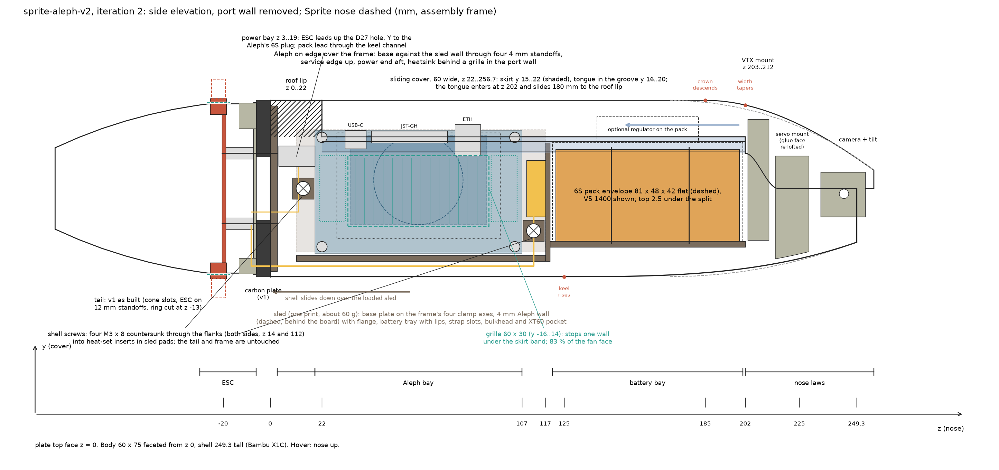
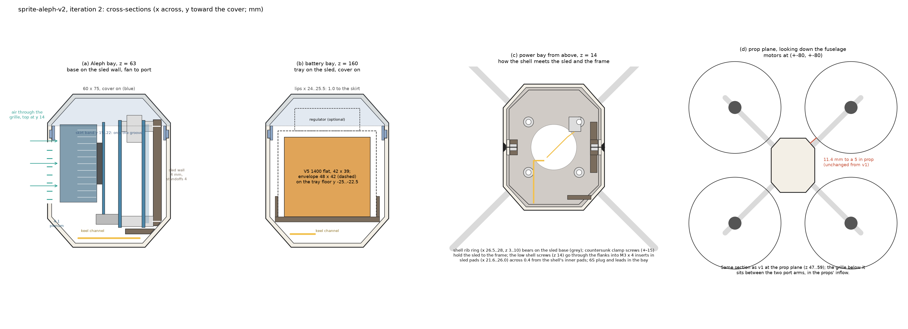
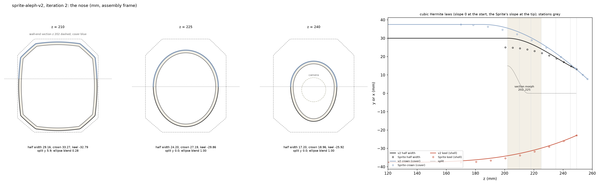
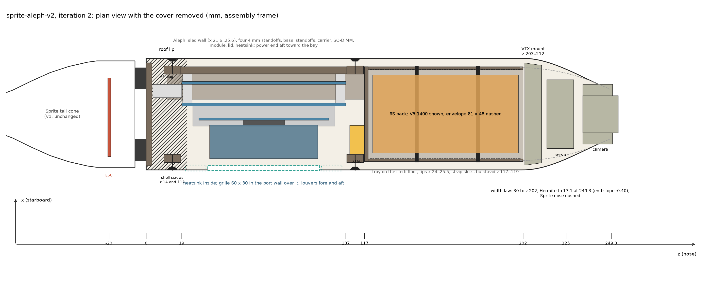

# sprite-aleph-v2: design proposal, iteration 2

Status: approved direction, 2026-09-30. A new direction after the v1 build (`docs/proposals/sprite-aleph`, iteration
3.1, built and passing): the Aleph and the battery swap places, both mount on a sled bolted to the carbon frame, the
shell becomes a sleeve that slides over the loaded sled, the cover goes back to the Sprite's sliding tongue-and-groove
with the groove respected everywhere, and the nose becomes one smooth taper into the Sprite's camera aperture. The tail
is v1's. Figures come from `figures.py` in this folder and carry the same numbers as the tables.

Coordinates are the sprite-drone assembly frame: z along the fuselage from the carbon plate's top face toward the nose,
y toward the top cover, x lateral (starboard positive). In hover the Sprite stands nose up. Lengths in mm.

## 0. Changes in iteration 2

- **Nose (new section 4.6):** long sleek taper, three cubic Hermite laws (keel from z 125, crown from 185, width from
  202) ending tangentially at the Sprite's aperture; the section morphs from the faceted body to a pair of half-ellipses
  by z 225. The wall end moves 198 -> 202; groove, tongue and skirt run z 22..202 and the cover travels 180.
- **Shell fixing corrected (your decision):** the iteration 1 lugs at (+-19, +-19) could not pass the Aleph board, its
  standoffs and the pack as the shell slides down, and no other vertical axis clears the slide, keeps carbon round the
  hole and misses the v1 rear mount's ring. The shell now fixes with four flush countersunk M3 through its flanks into
  heat-set inserts in pads on the sled (section 4.3). The frame and rear mount are v1 unchanged; the shell comes off
  without touching the ESC or the tail.
- **Split beyond the walls starts at y 15, not 22:** the cover's tongue and skirt enter from the nose, so past the wall
  end the shell may own nothing above the skirt band. The seam steps down the wall-end plane from y 22 to 15 (the
  Sprite's skirt-to-nose-wall transition); the surface is continuous.
- **Servo mount re-derived:** its glue face moves 0.25..0.65 up to the v2 nose floor; seat and servo position unchanged.

## 1. What changed from v1

| v1 (built) | v2 |
| --- | --- |
| Aleph bay z 106..198, battery bay z 6..88 | Aleph bay z 19..107, right over the frame; battery bay z 120..201 |
| Aleph on four bosses on the shell's starboard wall, M2.5 screws from outside | Aleph on a 4 mm sled wall (x 21.6..25.6) through four 4 mm metal standoffs; the shell carries nothing |
| cradle glued to the shell floor | battery tray is part of the sled; the shell has no floor |
| shell floor clamped by the frame's M3 screws; flare 50 -> 60 over z 2..10 | open-bottom sleeve, 60 x 75 from z 0 (no flare), slides down over the loaded sled; four flush M3 through the flanks into the sled, which is clamped to the frame |
| drop-on cover, groove unused; grille cut up to y 22 through the groove band | sliding cover, 7 mm skirt with the tongue in a groove at y 16..20 over z 22..202; nothing in the band y 15..22 on the walls; grille stops at y 14 |
| grille 61 x 34 (y -16..18) plus louvers to y 18 | grille 60 x 30 (y -16..14), louvers y -14..14 |
| connector alcove z 90..106 with the XT60 and the Aleph's 6S plug | power bay z 3..19 over the plate hole: ESC leads, Y to the Aleph's 6S plug; XT60 pocket in a 10 mm alcove at z 107..117 |
| blend 198..214 into the Sprite nose (the pyramid) | smooth nose: keel rises from 125, crown descends from 185, width tapers from 202, tangent to the Sprite aperture |
| VTX mount z 200..209, servo mount as the Sprite | VTX mount z 203..212 and servo mount re-derived to the v2 nose |
| tail: cone with two slots, ESC on 12 mm spacers, rear mount ring cut at z -13, launch pad notches | unchanged geometry (frame and rear mount included); hardware: 12 mm F-F standoffs instead of spacers so the ESC comes off alone |

## 2. The three rules this layout follows

1. **The shell mounts nothing.** Every payload interface (Aleph standoffs, battery tray, strap slots, XT60 pocket) is on
   the sled, which bolts to the frame with the frame's own four M3 clamp axes. Loading and wiring happen with the shell
   off. The shell is a skin with a groove, a grille, a rib ring at its open bottom and four flank pads for its own
   screws.
2. **The shell slides on along -z.** Nothing on the sled may stand outside the shell's inner section minus 0.4 at any
   height; the sled's widest features are the Aleph wall and screw pads (x 25.6 and 26.0) and the tray lips at x 25.5
   against an inner width of 56, and the shell's bottom rib ring (x 26.5..28) passes them by 0.5 or more. Every shell
   section contains all sections ahead of it (the nose laws are monotonic), so nothing on the shell sweeps through the
   sled. The flank screws go in once the shell is down.
3. **The cover slides on along -z and the groove band is sacred.** The skirt sweeps y 15..22 at x 26.6..27.8 over
   z 22..202 and its tongue sweeps y 16.05..19.95 out to x 29.1. Over that whole length the shell's inner side walls carry
   only the groove (y 16..20, 1.2 deep) and the sled stops at x 25.6 (1.0 clearance). Past z 202 the shell owns nothing
   above y 15, so the tongue and skirt enter freely. The grille and louvers end at y 14, one wall thickness under the
   skirt's edge. Above the split the payload stays inside the cover's inner section, which is prismatic over z 22..185
   and nested beyond; the connectors' tops (Ethernet, y 27.25) have 8 mm under the crown.

## 3. Components (measured / stated)

Unchanged from v1 section 3: Aleph base and carrier (88 x 52.5, holes on 82 x 46.5, 3.0 from the edges), stack layers
(base 1.56, standoffs to 11.56, carrier 13.13, module 19.69..20.89, SoC lid 23.52, heatsink to 41.52; 58 x 38 x 18 fan
heatsink, 49 g), service edge (Ethernet x 17.6..28.4 from the Ethernet end, JST-GH 31.7..64.2, USB-C 66.2..75.2; carrier
USB-C 42..51), 6S Molex 105430 on the x = 88 end, ARK 4IN1 ESC CONS (PCB 63.15 x 42.25, holes D3.5 on 30.5, 76.6 x 42.3 x
9.43 with the MR30s), battery envelope 81 x 48 x 42 flat, optional 18 V regulator 43.2 x 31.8 x 11, Sprite tail and frame.

New numbers used here:

| item | value | source |
| --- | --- | --- |
| Sprite cover skirt and tongue | ledge at the split; skirt 0.8 thick, 12.5 deep inside the wall; the tongue ends 20.5 short of the skirt, where the nose walls take over; tongue 1.2 out, 3.9 tall, 0.05 per side in a 4.0 groove | `designs/sprite-drone/parts/top-cover/contract.yaml`, main-shell brief |
| Sprite nose (assembly z) | keel -33.77 at 210.5, -29.08 at 230.5, -25.99 at 240.5, -22.9 at the tip 249.3; crown 24.81 at 228.5, 19.76 at 238.5, 7.8 at the brow 256.7; half width 17.02 at 240.5, 14.77 at 245.5, 13.1 at the tip | v1 `figures.py` stations from the Sprite STLs |
| Sprite camera hinge (assembly z; the shell contract's own z is 10 less) | U-rib z 242..246, notches x +-12.6..16.2, seat r 2.0 about (x, -2.28, 244), notch floor y -4.29; servo ledge z 214.85, servo floor y -29.27 | `designs/sprite-aleph/parts/main-shell/contract.yaml` |
| v1 servo mount glue face | y -30.45 at z 215.5, -29.90 at 218, -28.97 at 222, -28.22 at 225, -27.29 at 228.5; x +-18.45..14.93 | v1 servo mount STEP probed |
| frame and rear mount around the old lug axes | frame windows at |x| < 13.2 for |y| > 27 and a 3 mm web beyond y +-31; rear mount ring r 24.0..25.4 about (0, 11.6), z -6..-13.3 | v1 frame and rear mount STEPs probed (`results/_spikes/sprite-aleph-v2-sled/screw_axes.py`) |
| Aleph standoffs (yours) | M2.5 male-female, 4 mm body, brass or aluminium | assumed; 3 mm works, 5 mm costs 1 mm of plenum |
| shell screws | M3 x 8 countersunk (ISO 10642), M3 x 4 heat-set inserts (D4.0 hole) | stock hardware |

## 4. Layout

| z (mm) | what is there |
| --- | --- |
| -92..-6 | **Sprite tail cone, v1 unchanged**: ESC along the cone's axis, PCB z -20.6..-19.0, MR30s through the two 45 x 10 slots with the four relief notches, rear mount ring cut at z -13, launch pad with the two open-top notches |
| -6..0 | carbon plate, v1: D27 hole, clamp holes (+-15, +-15) |
| 0..3 | **sled base plate**, the shell's inner outline minus 0.3 (55.4 x 70.4 faceted), D27 opening, four countersunk M3 (+-15, +-15) into the frame |
| 3..19 | **power bay**: the shell's rib ring (z 3..10) stands on the sled base; the ESC's two 10 AWG leads and 8-pin harness come up the D27 hole; a Y to the Aleph's mated 6S plug (x 8.9..16.0, y 9.4..18.1, z 3.5..19) on the board's tail-facing end; the keel channel opens forward; the two low shell screws at z 14, y 0 |
| 19..107 | **Aleph bay**: board plane x 17.6 against the sled wall through 4 mm standoffs, board y -27.75..24.75, z 19..107, service edge up, power end aft; heatsink x -23.9..-5.9, y -15.4..22.6, z 34..92; fan face 4.1 from the port wall; grille y -16..14, z 33..93; louvers z 21..32 and 94..105 (y -14..14); the shell's roof lip closes the crown over z 0..22 |
| 107..117 | **alcove**: XT60 pocket on the tray bulkhead's aft face, x -22..-6, y +-12, z 109..117 (pack lead down, ESC leads up from the keel channel); the two high shell screws at z 112, y -18 |
| 117..119 | tray bulkhead (sled), y -31..19.5, harness notch at the top |
| 120..201 | **battery bay**: envelope 81 x 48 x 42 flat on the tray floor (y -25..-22.5), x +-24, y -22.5..19.5; lips x +-24..25.5, strap slots at z 145 and 178; optional regulator on the pack (velcro), x +-15.9, y 19.5..30.5, z 139..182; keel rising from 125, crown descending from 185 |
| 202 | side walls, groove and skirt end; the tongue enters here; the seam steps from y 22 to 15 |
| 202..249.3 | **nose** (4.6): width taper from 202, section morph to half-ellipses by 225; VTX mount z 203..212 with the cover's front screw at 207.5; servo mount 214.8..229.1; camera mounts and tilt (hinge z 244); shell tip 249.3, cover brow 256.7 |

### 4.1 Sled (new part, PETG or ASA, about 62 g)

One print, standing on its base plate, 202 tall. A concept mock-up built to these numbers (52.9 cm3 solid before
lightening windows, zero interference with the Aleph, battery, frame and rear mount, standoffs coaxial with the base's
holes) is in `results/_spikes/sprite-aleph-v2-sled/` (`sled-only.glb`, `sled-mockup.glb`, `viewer.html`, `report.md`).
It still shows the iteration 1 lugs and base holes; ignore those.

- **Base plate** z 0..3, the shell's inner outline minus 0.3. Four countersunk M3 x 16 at (+-15, +-15) go down through
  the frame and the rear mount into 12 mm M3 F-F standoffs (which replace v1's spacers and nuts and carry the ESC on four
  M3 x 6 from below). D27 opening over the plate hole. No other holes.
- **Aleph wall** x 21.6..25.6, y -27..25, z 11..117, standing on the base through its middle (|y| <= 15 over z 3..11)
  and on the flange. Four D2.5 holes at y -24.75 and 21.75, z 22 and 104 (the base's pattern, 82 x 46.5): tap M2.5 or
  fit short heat-set inserts. Where the shell's inner facet comes inboard of x 26.0 (|y| > 24.6) the wall's outer face
  follows it at 0.4, so the wall thins to about 2.1 at its edges; both holes sit in full 4 mm wall. Lightening windows
  between the holes are the worker's call.
- **Flange** y -31..-28.5, from the wall (its outboard edge clipped to the facet) inboard to x 8, z 11..117: the
  L-section that stiffens the wall. It starts above the shell's rib ring (z 3..10), which the mock-up showed it would
  otherwise hit; the wall's column carries the wall to the base. Port of x 8 the keel stays open as the wire channel,
  20 tall under the heatsink.
- **Tray**: floor y -25..-22.5, x +-25.5, z 117..202; lips x +-24..25.5 up to y -12.5 with strap slots through the floor
  at z 145 and 178; bulkhead z 117..119 spanning y -31..19.5 (it joins the flange, the wall and the tray), with the XT60
  pocket on its aft face and a notch at the top (x -22..-6, y 10..19.5) for the pack lead. The rising keel facet cuts
  the floor's outer corners (x +-25.5, y -25): they follow the shell's inner section at 0.4, a chamfer of up to 0.7 by
  z 202. The pack's corners keep 2.6 to the inner facet there.
- **Shell screw pads**, four, each 9 x 9 (y, z) and x 21.6..26.0 on its side, holding an M3 x 4 heat-set insert on an x
  axis (D4.0 hole, 4.2 deep from the pad face at x +-26.0):
  - low, (y 0, z 14): starboard, the Aleph wall's column thickened to x 26.0; port, a block x -26.0..-21.6, y -4.5..4.5,
    z 3..19 standing on the base (clear of the D27 opening by 8 and of the heatsink by 15);
  - high, (y -18, z 112): starboard, the Aleph wall thickened to x 26.0 (the board ends at z 107, its standoff at
    (y -24.75, z 104) is 6.2 away); port, a block x -26.0..-21.6, y -22.5..-13.5, z 107.5..117 hanging from the
    bulkhead (the XT60 pocket's wall at y -12 is 1.5 away).
- Nothing on the sled reaches x 26.0; above y 14 nothing reaches x 25.6; nothing reaches y 25.

### 4.2 Aleph on the sled (section a)

- Pose: aleph-stack frame (base board x 0..88 from the Ethernet end, y 0..52.5 with the service edge at y = 0, base bottom
  face z = 0, stack toward +z) to assembly (x, y, z) = (17.6 - sz, 24.75 - sy, 107 - sx). Same proper rotation as v1,
  translated: base against starboard, heatsink to port, service edge up, power end aft.
- Layers from the sled wall: standoffs 21.6..17.6, bottom-side parts 19.57..17.6 (1.97 in the 4 mm gap), base to 16.04,
  standoffs to 6.04, carrier to 4.47, SO-DIMM to -6.39 (y -26.25..-21.25), module -2.09..-3.29, lid to -5.92,
  heatsink -5.92..-23.92 (y -15.4..22.6). Plenum to the port wall (x -28): 4.1.
- Fixing (your hardware; the sled only has the holes): M2.5 male-female standoffs, 4 mm body, male end into the wall;
  swap the stack's base-to-carrier standoffs for male-female ones whose male ends pass the base board into our standoffs'
  female ends. No fastener sits on the wall's outer face. If you keep female-female stack standoffs, use M2.5 x 18 screws
  with heads in 2.5 mm counterbores on the wall's outer face; that leaves 1.5 of wall under the heads, so it is the
  fallback, not the plan.
- Margins: board bottom-outboard corner (17.6, -27.75) 5.8 to the inner facet; Ethernet top (y 27.25) 8.2 under the crown
  and 7.8 inside the facet at its x; SO-DIMM clear of the flange (2.25); fan face to wall 4.1.
- Grille: 60 x 30 (z 33..93, y -16..14) with printed bars in the port wall, covering 83 % of the fan face (D38 centred
  y 3.6); the fan's top 8.6 mm sits behind the skirt band and is fed sideways through the 4.1 plenum. Fin exhaust through
  louvers z 21..32 and 94..105, y -14..14. The grille sits between the two port arms, in the props' inflow.
- Ethernet, both USB-Cs and the JST-GH row point up, all forward of the roof lip (z 31.8 on); the 6S plug and the carrier's
  end USB-C / FFC face the power bay (a right-angle USB-C fits; a straight one does not).

### 4.3 Shell (sleeve) and its fixing

- Section: v1's 60 x 75 faceted outline (straight x +-30 for |y| <= 23.4, facets to (+-17.6, +-37.5), crown and keel 35
  wide, R6..R8 blends), wall 2.0, prismatic from z 0 to 125; from there the keel follows its law (4.6), and past 202 the
  whole section does. No flare: the rim overhangs the frame's straight sides by 5 and stands 1.4 outside the cone's rim;
  the frame edge is hidden between them.
- Roof lip z 0..22: the crown is closed over the power bay and the Aleph's aft 3 mm; rear cover pocket y 35.5, x +-3.55,
  z 9.45..22 for the reused rear cover mount (block to z 28.95, cover screw at z 25.5).
- Rib ring z 3..10, x 26.5..28 (1.5 thick) along the inner outline, bearing on the sled base.
- Groove y 16..20, 1.2 deep (x 28..29.2), z 22..202, open at 202. Nothing else on the inner side walls above y 14.
- Grille and louvers in the port wall as in 4.2; arm fairings and nacelle rings as v1; the nose as in 4.6.
- **Shell screws:** four M3 x 8 countersunk, heads flush in the flanks at (x +-30, y 0, z 14) and (x +-30, y -18,
  z 112). At each, an inner pad on the wall (D9, x 26.4..28, merged into the rib ring at the low pair) makes 3.6 of
  material for the 90 degree countersink; D3.4 clearance hole. The pad faces meet the sled pads across the 0.4 slide gap;
  the screw pulls them together and runs 4 into the insert (tip at x 22.0, inside the sled wall at starboard and inside
  the blocks at port). The low pair sits under the louvers (z 21), the high pair above them (z 105) with its axis 4.6
  inside the keel facet corner (y -22.6); none is in the skirt band.
- Removal: cover off (two screws, slide 180), four flank screws, slide the shell off along +z. The ESC, frame and tail
  stay put.

### 4.4 Cover (sliding, section a and b)

- v1's 60-wide crown re-derived with the Sprite's sliding scheme: split at y 22; skirt 1.2 thick at x +-26.6..27.8, y 15..22
  (7 deep, 0.2 to the wall); tongue x 27.8..29.1, y 16.05..19.95, over z 22..202 (0.05 per side, 0.1 at the bottom).
  Above the split the wall is 2.0 and flush with the shell; a 1.2 mm ledge at y 22..23.2, x 26.6..28, joins the skirt to
  the wall (the Sprite's ledge). Crown y 37.5 to z 185, then its law (4.6).
- Past z 202 the cover owns the whole section above the nose split (4.6), its side walls coming down to y 15 at 202, so
  the skirt merges into the nose walls there as on the Sprite.
- Slides on from the nose: the tongues enter at z 202 and travel 180 to the roof lip. Rear screw at z 25.5 into the rear
  cover mount, front screw at 207.5 into the VTX mount insert, front boss seated on the VTX neck.
- Length 22..256.7 (234.7); print standing on its rear end (as the v1 pack found) or flat.

### 4.5 Tail (unchanged geometry)

Rear shell, launch pad, ESC placement, MR30 slots and notches, rear mount (ring cut included) and carbon frame: v1 as
built, no new holes. One hardware note: the sled's clamp screws stop in 12 mm F-F standoffs under the rear mount (the ESC
hangs on those with four short screws). The ESC's clearance solid, slots and pad notches are untouched.

### 4.6 Nose (new)

All three lines are cubic Hermite curves in z with slope 0 where they leave the body and the Sprite's measured slope at
the tip, so each leaves tangentially and meets the aperture without a crease. With t = (z - z0) / (z1 - z0) and
L = z1 - z0: v(z) = (2t^3 - 3t^2 + 1) v0 + (3t^2 - 2t^3) v1 + (t^3 - t^2) L m1.

| law | z0, v0 | z1, v1 | end slope m1 | values |
| --- | --- | --- | --- | --- |
| half width W (shell and cover) | 202, 30 | 249.3, 13.1 | -0.40 | 29.16 at 210, 26.94 at 218, 24.20 at 225, 19.58 at 235, 16.97 at 240.5 (Sprite 17.02), 14.70 at 245.5 (14.77) |
| crown C (cover) | 185, 37.5 | 256.7, 7.8 | -0.72 | 35.50 at 202, 34.05 at 207.5, 33.27 at 210, 30.32 at 218, 27.19 at 225, 25.44 at 228.5 (Sprite 24.81), 21.91 at 235, 13.51 at 248.5 (13.63) |
| keel K (shell) | 125, -37.5 | 249.3, -22.9 | +0.35 | -35.82 at 185, -33.99 at 202, -32.28 at 213 (Sprite -33.4), -29.86 at 225, -28.67 at 230 (-29.1), -25.77 at 240.5 (-25.99) |

- **Section:** the faceted outline scaled to the laws (side vertices at (+-W, 23.4 W/30) and (+-W, -23.4 W/30), crown
  and keel vertices at (+-17.6 W/30, C) and (+-17.6 W/30, K)), blended radially into a pair of half-ellipses (semi-axes
  W and C above y 0, W and -K below, joined with vertical tangents at (+-W, 0)): r = (1 - b) r_facet + b r_ellipse,
  b = smoothstep((z - 202) / 23). At 202 the section is v1's (b = 0, with its R6..R8 blends); from 225 it is the
  ellipse pair (no facet edge past 225). Wall 2.0 normal to the skin. Loft smoothly (not ruled) through stations 202,
  210, 218, 225, 235, 245, 249.3; over 125..202 only the keel and crown vertices move.
- **Nesting:** W, C and |K| never increase with z and the ellipse lies inside the facet polygon, so every section contains
  the ones ahead of it (`figures.py` checks this every 0.5 mm from 185 to 249.3). The cover and the shell therefore slide
  along -z without meeting anything that fits in their final pose.
- **Split beyond the walls:** y 15 at z 202, smoothstep to y 0 at 216 (y 9.9 at 207.5, 0.3 at 214.8), y 0 to the
  aperture. At z 202 the seam runs down the wall-end plane from y 22 to 15; skirt, tongue and groove end there.
- **Aperture and camera, unchanged:** shell lip z 249.3 at keel y -22.9, half width 13.1; cover brow to 256.7 at y 7.8;
  hinge U-rib z 242..246 with notches x +-12.6..16.2, seat r 2 about (x, -2.28, 244); camera mounts and tilt as the
  Sprite. The v2 half width at 244 is 15.36 (Sprite about 15.44), so the notches keep their wall.
- **Servo mount (re-derived):** seat, servo position and the ledge z 214.85 unchanged; its glue face follows the v2 inner
  keel (y -29.95 at 214.8, -29.34 at 218, -28.52 at 222, -27.86 at 225, -27.04 at 228.5), 0.25..0.65 above v1's, and
  its sides stay inside the v2 inner section minus 0.3.
- **VTX mount (re-derived):** z 203..212, outline the v2 inner section minus 0.3, kept inside x +-26.2 above y 14.8 so
  the skirt and tongue pass it; neck top 0.3 under the cover's inner crown (31.75 at 207.5); front screw insert at 207.5.
- The pack's forward end (z 201) keeps 2.6 to the keel facet, and the tray floor's corners are chamfered (4.1).

## 5. Numbers and clearances

| quantity | value |
| --- | --- |
| body section | v1's 60 x 75 faceted from z 0; nearest point 74.9 from a motor axis: 11.4 mm to a 5 in prop |
| shell height / footprint | 249.3 / 188 x 188 standing; cover 234.7; sled 202 standing: all fit the X1C |
| shell slide-on | inner outline 56 x 71; sled max x 26.0 (screw pads), 25.6 (wall), 25.5 (lips); rib ring opening x +-26.5: 0.5 clearance; nested nose sections |
| cover slide | skirt sweep x 26.6..27.8, y 15..22, z 22..202; sled wall 25.6 (1.0); groove y 16..20 x 28..29.2; tongue 16.05..19.95 to x 29.1; travel 180; no shell above y 15 past 202 |
| grille to band | grille top y 14, skirt edge y 15, groove bottom lip y 15..16 |
| Aleph board plane / holes | x 17.6; y -24.75, 21.75; z 22, 104; standoffs 4; wall 21.6..25.6 |
| Aleph margins | corner 5.8; Ethernet 8.2 under the crown; plenum 4.1; the sled wall's top edge (y 25) follows the inner facet at 0.4 |
| power bay | z 3..19; 6S plug x 8.9..16.0, y 9.4..18.1, z 3.5..19; low screw pads at y 0, z 9.5..18.5 |
| shell screws | (x +-30, y 0, z 14) and (x +-30, y -18, z 112); M3 x 8 countersunk into M3 x 4 inserts; 3.6 of shell at the head, 4.4 of sled pad |
| battery envelope | z 120..201, x +-24, y -22.5..19.5; lips x +-24..25.5; bulkhead z 117..119; pack top 2.5 under the split |
| pack forward end | z 201, 2.6 inside the keel facet; VTX mount 203..212 |
| nose | laws in 4.6; ellipse pair from z 225; split y 15 -> 0 over 202..216; aperture, hinge and servo seat as the Sprite |
| ESC | v1: PCB to shell 1.2, sockets to slot 1.35, to ring 1.4, to bosses 1.1 |

## 6. Mass, balance, props

| item | v1 | v2 |
| --- | --- | --- |
| printed parts (launch pad excluded) | about 225 g | about 258 g (sled +62, cradle -10, shell floor / flare / bosses / cells -21, cover skirt +4, lugs out and pads in -2) |
| carbon plate, ESC, Aleph, battery, motors and the rest | 630 g | 630 g |
| all-up | about 855 g | about 890 g, plus the regulator if fitted |

Centre of mass about 87 mm above the plate (v1 70, Sprite 78): the pack moves forward 113 mm and the Aleph aft 88. Prop
clearance 11.4 mm with 5 in props, unchanged; the section at the prop plane (z 47..59) is the same polygon.

## 7. Parts plan

| body | design | disposition | notes |
| --- | --- | --- | --- |
| mainFrame | sprite-aleph-v2-main-frame | reuse v1 verbatim | unchanged (motor pattern parameter as v1) |
| mountingSled | sprite-aleph-v2-sled | new, one file | base plate, Aleph wall with four holes, flange, tray with lips, slots, bulkhead, XT60 pocket, four screw pads with inserts |
| mainShell | sprite-aleph-v2-main-shell | new skin, one file | open-bottom sleeve, no flare, roof lip 0..22, rib ring, four flank pads and countersunk holes, groove, grille and louvers to y 14, nose laws 4.6 |
| topCover | sprite-aleph-v2-top-cover | modified skin, one file | 60 wide sliding cover, 7 mm skirt with tongue z 22..202, crown law, nose hood to 256.7 |
| rearMount | sprite-aleph-v2-rear-mount | reuse v1 verbatim | unchanged |
| vtxMount | sprite-aleph-v2-vtx-mount | modified | v1 re-derived at z 203..212 to the v2 inner section, screw insert at 207.5 |
| servoMount | sprite-aleph-v2-servo-mount | modified | Sprite servo mount, glue face re-lofted to the v2 floor over z 214.8..229.1; seat and position unchanged |
| rearShell, launchPad, ark4in1Esc | sprite-aleph-v2-rear-shell, -launch-pad, -esc-envelope | reuse v1 verbatim | unchanged |
| motorCover1..4, camMountL, camMountR, rearCoverMount | sprite-aleph-v2-motor-cover, -cam-mount-l, -cam-mount-r, -rear-cover-mount | reuse Sprite verbatim | rear cover mount placed at z 9.45..28.95 |
| batteryCradle | | dropped | part of the sled |
| alephStandoff1..4 | purchased clearance bodies | new | D5 x 4 cylinders on the four hole axes |
| shellScrew1..4 | purchased clearance bodies | new | M3 x 8 countersunk on the four screw axes (the inserts are hole features of the sled) |
| alephBase, alephCarrier, alephModule, alephHeatsink, battery, regulator | purchased clearance bodies | as v1 | new poses |

Printed designs: 12 (3 new: sled, shell, cover; 2 modified: VTX mount, servo mount; 3 v1: rear mount, rear shell, launch
pad; 4 Sprite: motor cover, two camera mounts, rear cover mount), plus the v1 carbon frame.

## 8. Build plan in opencad

1. `assembly stage sprite-aleph-v2` with the v1 designs and built sources as bases (frame, rear mount, VTX mount, shell,
   cover), the Sprite contracts for the reused parts and the servo mount, the aleph-stack bodies, the ESC STEP, this
   proposal and figures.
2. Draft and blockout on Codex (`assembly drive --stop-after blockout`, `OPENCAD_WORKER=codex`, no fallback). Review the
   new and modified contracts against sections 4.1..4.6 before any model turn: the groove band, the slide envelopes, the
   grille top, the screw pads and the nose laws are the numbers to check.
3. Sled, shell and cover one file each at max effort (`run --no-decompose --worker codex`), then the full drive.
4. Assembly acceptance: `shellSlide` (shell translated +z 0..250 clear of the sled, stack, pack), `coverSlide` (cover
   translated +z 0..180 clear of everything), `skirtBandClear` (no shell or sled material at x 26.4..29.2, y 14.8..22.2,
   z 22..202 except the groove's lips, and no shell above y 15 past 202), `grilleTop <= 14`, `fanPlenum >= 4`,
   `alephToSkin >= 3`, `propTipToBody >= 11` with a 5 in circle, `batteryEnvelopeClear`, `escSlotClearance 1..2` (v1),
   `camSweep` (v1), `shellScrewsCoaxial` (shell hole, sled insert and screw body on each axis within 0.1),
   `noseSmooth` (outer outline at z 225, 235 and 245 within 0.3 of the half-ellipse pair; tessellated dihedral angle
   <= 15 degrees over z 205..248 away from the split and aperture edges), `apertureUnchanged` (lip z, keel y, half width,
   brow and hinge seats as the Sprite within 0.1); passages: grille to fan face, louvers to fin ends, D27 hole to the
   power bay, keel channel to the alcove.
5. Independent OpenCascade checks (prop plane above the nacelles, slide sweeps, groove continuity, grille open area, nose
   fits and dihedral scan) and cad-qa on the new or modified parts; print pack as for v1.

## 9. Decisions

1. **Shell fixing:** four flush countersunk M3 through the flanks into the sled (your choice in iteration 2); frame and
   rear mount unchanged, the ESC stays on to remove the shell.
2. **Aleph hardware:** male-female standoffs both sides of the base board (plan) or counterbored screws from the wall's
   outer face (fallback, 1.5 mm of wall under the heads).
3. **Grille:** 83 % of the fan face open, the rest fed through the plenum; the only way to open more is a lower split, which
   costs battery-swap room (pack top 2.5 under the split now).
4. **Frame body:** keep 50 x 75 (the shell rim overhangs its straight sides by 5, hidden by the cone rim).
5. **Regulator:** on the pack with velcro, not on the cover (the cover slides 180 mm).
6. **Nose:** long taper (your choice): keel from 125, crown from 185, width from 202.
7. Carried over from v1: X1C, 5 in props at 11.4, frame in carbon with the motor pattern set before cutting, Aleph on 6S,
   ESC holes reamed to D3.8, PETG or ASA for shell, cover and sled.

## Sources

- `docs/proposals/sprite-aleph/proposal.md` (v1, iteration 3.1) and its build: `results/build123d/sprite-aleph/`,
  `results/_spikes/sprite-aleph-qa/occ_checks.json`.
- `designs/sprite-drone/parts/top-cover/contract.yaml` and `main-shell/brief.md` (skirt, tongue and groove measurements);
  `designs/sprite-aleph/parts/main-shell/contract.yaml` (hinge, servo ledge); `designs/aleph-stack/`;
  `scratch/sprite/6s_power_propulsion_and_fc_baseline.md`.
- `results/_spikes/sprite-aleph-v2-sled/` (mock-up, `lanes.py` slide lanes, `screw_axes.py` vertical-axis search).
- [ARK 4IN1 ESC CONS](https://arkelectron.com/product/ark-4in1-esc-cons/), STEP in the [ARK repository](https://github.com/ARK-Electronics/ARK_4IN1_ESC/tree/main/ARK_4IN1_ESC_CONNECTORIZED).
