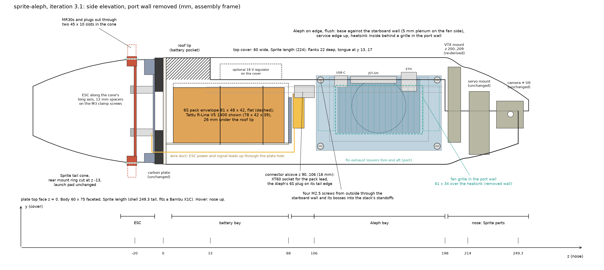
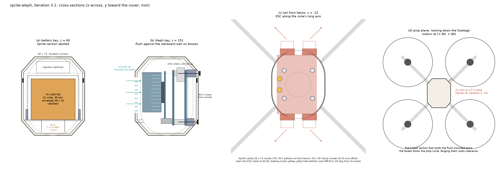
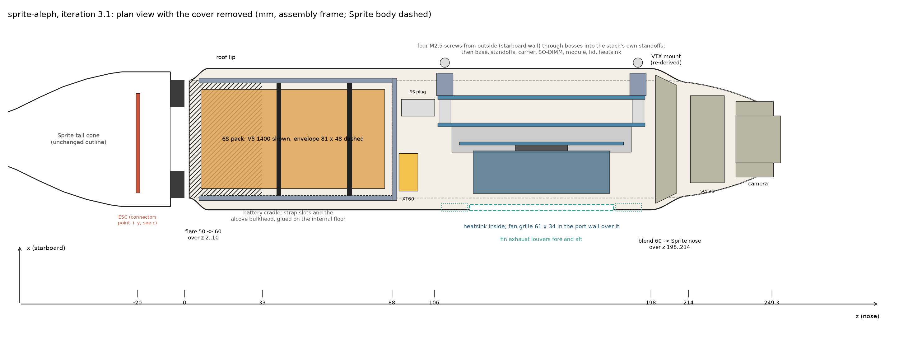

# sprite-aleph: design proposal, iteration 3.1

Status: frozen for drafting, 2026-09-29. Iteration 3 without the length stretch, for a Bambu X1C (256 mm Z), with the
decisions from the review folded in (section 9). This document is the intent source for `designs/sprite-aleph`: its
numbers are the ones the contracts carry. Iterations 1 and 2 are kept under `v1/` and `v2/`. Figures come from
`figures.py` in this folder and carry the same numbers as the tables.

Coordinates are the sprite-drone assembly frame: z along the fuselage from the carbon plate's top face toward the nose,
y toward the top cover, x lateral (starboard positive). In hover the Sprite stands nose up. Lengths in mm.

## 1. What changed

Iteration 3 took your tweaks: Aleph screwed to the wall from outside through new mounting points, fan inside with vents
over it, body widened only as much as that needs; tail back to the Sprite's shape with holes for the connectors, ESC turned
so each connector is nearest its motor; power connector on the tail-facing end.

| iteration 2 | iteration 3.1 |
| --- | --- |
| body 50 x 75 stadium, heatsink 6 mm out through a wall window and a cover notch | body 60 x 75 with faceted corners; heatsink inside behind a 61 x 34 grille in the port wall, 5 mm plenum |
| Aleph on a glued port rail | Aleph base against the starboard wall on four bosses; M2.5 screws from outside into the stack's own standoffs |
| tail bulb D112, ESC at 45 deg, new rear shell, rear mount, launch pad | Sprite cone kept (two 45 x 10 connector slots with PCB relief notches); ESC along the cone's long axis on 12 mm spacers on the frame's own M3 clamp screws; rear mount ring cut at z -13; launch pad with two open-top plug notches |
| 249 mm shell | 249.3 mm shell kept (fits the X1C): VTX mount moved forward to z 200..209, side walls to z 198; Aleph to VTX mount 3.5 -> 4.5 |
| 14.1 mm to a 5 in prop | 11.4 mm (Sprite 16.2), accepted |

From iteration 3 to 3.1: the +20 stretch is gone (a 269 mm shell does not fit 256 mm of Z); the stack swaps sides (base on
the starboard wall, grille in the port wall: the aleph-stack STEP is right-handed, and with the service edge up and the
power end aft its heatsink faces port; iteration 3 had drawn its mirror image, and the section is symmetric so no margin
changes); the flare is shortened to
z 2..10 so the 48 wide battery envelope clears the plate end; the cradle bulkhead moves to z 88 and the alcove is 16 mm;
an optional 18 V regulator envelope sits over the pack under the cover; the rear mount keeps a short ring; the frame's motor
pattern becomes a parameter for the carbon cut.

## 2. The trade the flush mount forces

A wall-mounted on-edge Aleph is 45.5 thick (2.5 boss gap, 23.5 stack, 18 heatsink) plus a fan plenum, and its boards are
52.5 tall (55 with the Ethernet jack). Its corners sit at about x = +20, y = +-29 and x = -23, y = 23. Every body section
that contains those corners has its outer skin at (23, 31) or further out, and that point is 75 mm from a motor axis: with
5 in props the ceiling is 11.5 mm of tip clearance, whatever the shape. The section drawn here is the fullest one that holds
the stack: straight sides for abs(y) <= 23.4, then flat facets that follow the prop circle to a 35 wide crown and keel. Its
nearest point is 11.4 mm from a 5 in prop (Sprite 16.2). You accepted 11.4 and have smaller props if needed (4.5 in: 17.8).

## 3. Components (measured / stated)

| item | value | source |
| --- | --- | --- |
| Aleph base and carrier | 88.0 x 52.5, D2.9 holes on 82.0 x 46.5, 3.0 from the edges; M2.5 standoffs 10 long between them | `designs/aleph-stack` |
| stack above the base bottom face | base 1.56, standoffs to 11.56, carrier 13.13, module 19.69..20.89, SoC lid 23.52, heatsink to 41.52 | aleph-stack contract; heatsink 58 x 38 x 18, 49 g from you |
| service edge (base y = 0, long edge) | ix Ethernet x 17.6..28.4 (7.3 tall, overhangs 2.5), JST-GH x 31.7..64.2, USB-C x 66.2..75.2; carrier bottom USB-C x 42..51 | aleph-stack contract |
| base x = 88 end | 6S power connector (Molex 105430, y 6.65..15.39, overhangs 1.31) beside the end USB-C; opposite end from the Ethernet | you, matches the STEP |
| ARK 4IN1 ESC CONS | PCB 63.15 x 42.25 x 1.61; 76.6 x 42.3 x 9.43 with MR30s; holes D3.5 on 30.5 x 30.5; battery studs M2.5 at (+-6, -20); parts +4.85 / -4.58; 24 g | ARK STEP Rev 4.0 |
| battery envelope | 81 long x 48 wide x 42 tall, laid flat. Covers Tattu R-Line V5 1400 (78 x 42 x 39, 222 g, reference), Tattu V6 1700 (78.5 x 40.9 x 38.4), GNB 1300 (80 x 38 x 34), CNHL 1300 (76 x 48 x 35 flat). A 2200 (106 long) does not fit | vendor; `scratch/sprite/6s_power_propulsion_and_fc_baseline.md` |
| 18 V regulator (optional) | Pololu D42V110F18, 43.2 x 31.8 x 11; the Aleph runs on 6S directly without it | baseline notes |
| Sprite tail | cavity 56 x 73 inside (r 28 at +-x, r 36.5 at +-y) to z = -30; wall 0.8; arm undersides 12 wide to z = -24; cone open at the tip | rear shell STL |
| frame | centre body 50 x 75; D27 centre hole; M3 clamp holes on 30 x 30 through shell floor, plate and rear mount (M3 x 30); motor slots on 12 x 12 at (+-80, +-80) | frame STL |

## 4. Layout

| z (mm) | what is there |
| --- | --- |
| -92..-6 | **Sprite tail cone**, unchanged outline. Inside: the ESC on 12 mm spacers under the rear mount plate, PCB z -20.6..-19.0, its long axis along y (the cone's long axis); MR30 sockets on the down side (z -25.5..-18.6) poke 1.8 through the cone's +-y walls, plugs fully outside; two 45 x 10 slots (x +-22.5, z -27..-17) in the cone let the sockets and the PCB's ends through; the PCB is off-centre (x -22.75..19.5), so four symmetric relief notches (x +-22.5..24.0, z -21.8..-17.8) at the slot ends clear its edge by 1.2, leaving the arm-root bridges intact above and below. Air: the Sprite's +-x rim inlets plus the slots, out the open tip |
| -6..0 | carbon plate; leads through the D27 hole |
| 0..2 | shell floor |
| 2..10 | ring flares from the plate's 50 x 75 stadium to the 60 x 75 faceted section (cosine, at most 45 deg from vertical as printed); roof to z = 33 |
| 6..88 | **battery bay**: internal floor (y = -22.5) and wire duct kept; pack envelope z 7..88, x +-24, y -22.5..19.5 in a glued cradle, 26 mm under the roof lip, strap slots at z 40 and 70; the optional regulator over it on the cover's inside (x +-15.9, y 22..33, z 40..83.2) |
| 88..106 | cradle bulkhead z 88..90, then the **connector alcove** z 90..106 (16 mm): XT60 socket (pack lead, axis along y) at x -22..-6, z 91..99; the Aleph's 6S plug on the base's tail-facing end (plug body x 9.8..16.9, y 9.4..18.1, z 92..106); cables from the duct |
| 106..198 | **Aleph bay**: base against the starboard wall on four bosses, board plane x = 18.5, board y -27.75..24.75, z 107.5..195.5, service edge up, power end aft; heatsink x -23..-5, y -15.4..22.6, z 122.5..180.5; fan face at x -23, inner wall at -28; grille y -16..18, z 121..182 in the port wall; fin louvers z 109..120 and 183..194 |
| 198 | side walls end (the Sprite's end at 170.16); the cover closes y > 0 from here |
| 198..214 | **blend** in width and height from the 60 x 75 section into the Sprite nose section at z 214; VTX mount z 200..209 inside it |
| 214..257 | **nose**: the Sprite's own stations, servo mount (z 214.8), camera mounts and tilt (hinge z 244), shell tip 249.3, cover tip 256.7 |

### 4.1 Aleph, flush against the starboard wall (section b)

- Pose: the aleph-stack frame (base board x 0..88, y 0..52.5 with the service edge at y = 0, base bottom face z = 0, stack
  toward +z) maps to the assembly as (x, y, z) = (18.5 - sz, 24.75 - sy, 195.5 - sx), a proper rotation.
- Four bosses on the shell's inner starboard wall at the base's hole pattern: y -24.75 and 21.75, z 110.5 and 192.5. They reach
  from the curved wall to the board plane x = 18.5: 7.6 long at the lower holes, 9.5 at the upper (D7, teardrop underside
  for printing), M2.5 through holes continued through the wall with a spot face outside.
- M2.5 screws from outside pass wall, boss and base board and thread into the stack's own base-to-carrier standoffs (assumed
  female-female; M2.5 x 18 lower, x 20 upper). If they turn out male-female, M2.5 heat-set inserts in the bosses and screws
  from inside. The base's bottom-side parts (1.97) sit in the 2.5 gap; the microSD on that side faces the wall and is
  reachable only with the stack out.
- Layers from the wall: bottom parts 20.47..18.5, base to 16.94, standoffs to 6.94, carrier to 5.37, SO-DIMM housing to
  -5.49 at y -26.25..-21.25, module -1.19..-2.39 (y -21.25..23.75), SoC lid to -5.02, heatsink -5.02..-23.02 (y -15.4..22.6).
- Margins: board bottom-outboard corner 3.2 to the inner facet; Ethernet top (y 27.25) 7.6 under the inner facet at its x;
  SO-DIMM corner clear of the keel; fan face 5.0 from the inner wall, and the heatsink's top corner (y 22.6) sits exactly
  where the straight band ends, so it keeps the same 5.0.
- Grille: 61 x 34 opening (y -16..18) with printed bars in the port wall, 4 mm below the shell/cover split at y 22. The
  fan draws outside air through it; the fins exhaust fore and aft through two louver groups. No cut in the cover.
- Ethernet, both USB-Cs and the JST-GH row point up under the cover; the 6S power plug and the carrier's USB-C and FFC face
  the alcove; the x = 0 end faces the VTX mount, 4.5 away (board end z 195.5, mount z 200).

### 4.2 Body section and cover

- Outer 60 x 75: straight sides x = +-30 for abs(y) <= 23.4, facets to (+-17.6, +-37.5), flat crown and keel 35 wide,
  corners blended R6 to R8. Wall 2.0. Inner width at the internal floor (y = -22.5): 56.
- Shell/cover split at y = 22 (Sprite 12.5), inside the straight band. The cover drops on along -y instead of sliding:
  a sliding flank sweeps the whole groove, so it could pass neither the upper Aleph bosses (y 18.25..25.25, which cross the
  split) nor leave the grille open (the port flank sat behind its upper half). Cover flanks 22 deep inside the walls
  (0.2 clearance) only over the battery bay z 33..106, no tongues; over the Aleph bay z 106..198 the cover wall stands on
  the shell's wall tops, with two notches at the starboard edge for the upper boss tops (x 25..30, y 22..25.25,
  z 105.8..114 and 187.8..196). The shell's groove (y 13..17, z 30..196) stays but is unused. Rear screw into the rear
  cover mount at z 36.5 (roof pocket unchanged, the crown is flat there), front screw into the VTX mount insert at
  z 204, the cover's front boss seated on the VTX neck top (y 33).
- Flare z 2..10 from the plate's 50 x 75 footprint, a cosine with its steepest point at 45 deg so the standing shell prints
  without support. At z 7, where the pack envelope starts, the flare is 70% done and the inner wall is about 1.7 outside
  the envelope's corners; `batteryEnvelopeClear` checks it on the model. Blend z 198..214 (cosine, width and height) into the
  Sprite nose section; Sprite nose stations from z 214 to the tip at 249.3; cover to 256.7 (224 long).
- VTX mount: the Sprite plate re-derived to the blend's inner outline at z 200..209 with 0.5 clearance, same M2 pattern and
  cover-screw insert axis.
- Battery: envelope flat on the 56 wide floor, 4 per side to the wall for the cradle lips (x +-24..26); top at y 19.5, 2.5
  under the split. The regulator envelope over it is 2.5 above the pack and 2.7 inside the cover's facets.
- Material: PETG or ASA for the shell and cover (wider, longer skin with the grille cut-out).

### 4.3 Tail (section c)

- ESC along y, 30.5 pattern centred on the axis: its holes fall on the frame's M3 x 30 clamp screws with a 0.25 mm offset
  per axis (30.5 versus 30.0), more than the D3.5 holes' slack, so you ream the ESC holes to D3.8; CAD places the ESC on the
  30 x 30 clamp axes. Spacers 12 mm on the screws between the rear mount plate (z -7.2) and the ESC, nuts below:
  9.2 + 12 + 1.6 + 2.4 = 25.2 of the 30 mm screw.
- Rear mount: the Sprite plate with its ring wall cut at z -13 (flush with the +-y cross-bore bosses, bottom -13.3) and the
  U-channel tab removed; side lands (x +-25, z -6..-9) stay, so the rear shell locates as before on the short ring, the lands
  and its two pins. The ESC's upper parts (4.58) reach z -14.4: 1.4 under the ring, 1.1 under the bosses.
- The PCB (x -22.75..19.5, y +-31.6) fits the cavity across (r 28) but its end corners (r 38 at 56 deg) and the MR30 sockets
  (y to 38.3) pass through the two slots; each socket's mated plug sits outside at y 38.3..46.5, 29 deg from its motor. A
  30 deg turn from the 45 deg layout would have left two connectors 43 deg from theirs; along the axis all four are 29.
- Battery studs at (-20, +-6): two 10 AWG cables and the 8-pin harness go up the D27 hole into the duct, about 110 mm to the
  alcove (150 mm supplied).
- Flight controller reservation: a Kakute-class 30.5 board could later stack under the ESC on M3 x 40 clamp screws (cone
  inside r 27 x 35 at z -31); not modelled.
- Rear shell: the Sprite part with two slots. Launch pad: the plugs and PCB ends leave through the cup's end caps, so an open-top notch x +-24.5 down to z -27 in each cap clears them (plugs 1.5, PCB 1.75); the shell still seats on four cap contacts at |x| 24.5..25.9, |y| 26.5..29.

## 5. Numbers and clearances

| quantity | value |
| --- | --- |
| body section | 60 x 75 faceted; nearest point 74.9 from a motor axis: 11.4 mm to a 5 in prop, 17.8 to 4.5 in |
| shell height / footprint | 249.3 / 188 x 188, printed standing: fits the X1C (256 x 256 x 256) |
| top cover | 224 long (z 33..256.7), printed flat |
| Aleph board plane / holes | x 18.5; y -24.75, 21.75; z 110.5, 192.5; bosses 7.6 and 9.5 long |
| Aleph margins | board corner 3.2; Ethernet 7.6; fan plenum 5.0 (also at the heatsink's top corner); to VTX mount 4.5; 6S plug 2 from the bulkhead |
| grille / louvers | 61 x 34 at y -16..18, z 121..182; louvers z 109..120 and 183..194, y -14..18 |
| battery envelope | 81 x 48 x 42 flat: z 7..88, x +-24, y -22.5..19.5; cradle lips x +-24..26, bulkhead z 88..90 |
| regulator envelope (optional) | x +-15.9, y 22..33, z 40..83.2, on the cover's inside |
| alcove | z 90..106: XT60 (x -22..-6, z 91..99), 6S plug body x 9.8..16.9, z 92..106 |
| ESC | PCB z -20.6..-19.0; sockets y +-31.6..38.3 through the cone (skin at 36.5..37.3); plugs to 46.5; slots 45 x 10 at x +-22.5, z -27..-17, relief notches x +-22.5..24.0, z -21.8..-17.8; PCB to shell 1.2, sockets to slot 1.35 |
| ESC to rear mount | 1.4 to the ring (cut at z -13), 1.1 to the bosses (-13.3); parts top z -14.4 |
| clamp screw use | 25.2 of 30 mm |

## 6. Mass, balance, props

| item | Sprite (one 4S 1500) | sprite-aleph |
| --- | --- | --- |
| printed parts (PLA 1.24, launch pad excluded) | about 200 g | about 225 g (shell wider +18, cover +3, cradle 10, minus ESC bracket and XT60 mount) |
| carbon plate | 67 g | 67 g |
| FC / ESC | about 18 g | ESC 24 g, Aleph about 135 g |
| battery | about 180 g | 222 g (V5 1400) |
| motors, props, camera, VTX, servo, RX/GPS, wiring | about 180 g | about 180 g |
| all-up | about 640 g | about 855 g, plus the regulator if fitted |

Centre of mass about 70 mm above the plate (Sprite about 78). Prop clearance 11.4 mm with 5 in props (Sprite 16.2), 17.8 with
4.5 in, 24 with 4 in; the props turn above the nacelle rings (top z 46.9; arm fairings end at z 25), where the body is the full section.

## 7. Parts plan

| body | design | disposition | notes |
| --- | --- | --- | --- |
| mainFrame | sprite-aleph-main-frame | reuse | carbon plate, datum; the Sprite contract with the motor bolt pattern as a parameter (default the measured 12 x 12 slots; set to your motor before cutting) |
| motorCover1..4, servoMount, camMountL, camMountR, rearCoverMount, launchPad | reuse | | six Sprite designs, nine bodies |
| mainShell | sprite-aleph-main-shell | modified skin | 60 x 75 faceted section, Sprite length, flare z 2..10, blend z 198..214, four Aleph bosses with through holes, grille and louvers, internal floor and cells to z 88, cradle glue seats, walls to z 198; Sprite nose from z 214 |
| topCover | sprite-aleph-top-cover | modified skin | 60 wide, Sprite length, drop-on: flanks 22 deep over z 33..106 only, no tongues, boss-top notches, blend 198..214, Sprite cover nose from 214, front screw at z 204 |
| rearShell | sprite-aleph-rear-shell | modified | two 45 x 10 connector slots at +-y, z -27..-17, four PCB relief notches x +-22.5..24.0, z -21.8..-17.8 |
| rearMount | sprite-aleph-rear-mount | modified | ring wall cut at z -13, U tab removed |
| vtxMount | sprite-aleph-vtx-mount | modified | moved to z 200..209, plate re-derived to the blend's inner outline, same M2 pattern and insert axis |
| batteryCradle | sprite-aleph-battery-cradle | new, prismatic | no shelf: the pack sits on the shell floor; lips at x +-24..26 glued to the floor (y -22.5) with strap slots, bulkhead z 88..90 with the XT60 pocket |
| ark4in1Esc | sprite-aleph-esc-envelope | new, clearance solid | one solid from the measured ESC numbers: PCB, parts, MR30 sockets and mated plugs |
| escMount, xt60mMount | | dropped | |
| alephBase, alephCarrier, alephModule, alephHeatsink (58 x 38 x 18), battery envelope, regulator envelope | purchased clearance bodies | new | Aleph from the aleph-stack STEP bodies; the rest boxes |

Printed designs: 13 today, 12 proposed (6 reused, 5 modified, 1 new), plus the carbon plate and the ESC clearance solid.
Bodies: 17 today, 16 printed and structural plus about 8 purchased clearance bodies.

## 8. Build plan in opencad

1. Stage sources with `assembly stage`: the Sprite's 14 STLs and guide, the 13 sprite-drone contracts and briefs (reuse and
   modification bases) and built sources (seeds), the aleph-stack STEP bodies, the ARK ESC STEP (provenance), this proposal
   and the 6S baseline notes.
2. Draft and blockout on Codex GPT-6 Astra (`assembly drive --stop-after blockout`). Reused parts: the sprite-drone
   contracts. Modified skins: the new section is analytic (the facet polygon above), the flare and blend are lofts between
   stated stations, the nose stations are the Sprite's measured ones; the Sprite meshes stay sources for the unchanged
   stations only (sections, faces and probes, no whole-part fidelity band). The rear shell and rear mount are the Sprite
   contracts plus slot / cut features with probes.
3. Skins one file each on the high-effort model (retrospective R5, R6): `run --no-decompose` for the main shell, top cover
   and rear shell before the assembly drive.
4. Assembly acceptance: cover seat on the wall tops and flanks (drop-on), cover clear of the VTX mount; `alephToSkin >= 3`, `fanPlenum >= 4.5`,
   `ethernetToCover >= 5`, `alephToVtx >= 4`, `batteryEnvelopeClear`, `regulatorEnvelopeClear`, `escToBosses >= 1`,
   `escSlotClearance 1..2`, `propTipToBody >= 11` with a 5 in construction circle; passages: grille to fan face, louvers to
   fin ends, duct from the D27 hole to the alcove, cone inlets and slots to the tip; `camSweep` as before.
5. Full `assembly drive` on Codex, then independent OpenCascade checks and cad-qa on the modified parts.
6. Print check: shell (249.3 tall, standing) and cover (flat), then fit the stack through the bosses and the ESC through the
   cone slots before wiring.

## 9. Decisions (review of 2026-09-29)

1. **Printer:** Bambu X1C, 256 mm Z: no stretch; the room comes from the VTX mount moving into the nose taper.
2. **Props:** 5 in, 11.4 mm clearance accepted; smaller props on hand.
3. **Frame:** cut in carbon; the motor bolt pattern is a parameter, to be set to your motor before the file goes out.
4. **Power:** Aleph on 6S directly; the 18 V regulator is optional and has a reserved envelope over the pack.
5. **Stack standoffs:** assumed female-female (screws from outside); M2.5 inserts in the bosses are the fallback.
6. **ESC holes:** reamed to D3.8 by you.
7. **Rear shell location:** short ring kept (cut at z -13) plus the lands and pins.
8. **Material:** PETG or ASA for the shell and cover.

## Sources

- `designs/sprite-drone/` contracts and source STLs; `designs/aleph-stack/`; `docs/notes/sprite-drone-retrospective.md`;
  `scratch/sprite/6s_power_propulsion_and_fc_baseline.md`.
- [ARK 4IN1 ESC CONS](https://arkelectron.com/product/ark-4in1-esc-cons/), [pinout](https://docs.arkelectron.com/products/electronic-speed-controller/ark-4in1-esc/pinout), STEP in the [ARK repository](https://github.com/ARK-Electronics/ARK_4IN1_ESC/tree/main/ARK_4IN1_ESC_CONNECTORIZED).
- [Tattu R-Line V5 1400 mAh 6S](https://www.tattuworld.com/products/tattu-r-line-5-0-1400mah-6s1p-22-2v-150c-fpv-lipo-battery.html); [GNB 1300 mAh 6S 120C](https://rotorvillage.ca/gnb-1300mah-6s-120c-lipo-xt60/); [CNHL Black Series 1300 mAh 6S](https://n-factory.de/CNHL-6S-100C-1300mAh-V2-LiPo-Black-Series-en).
