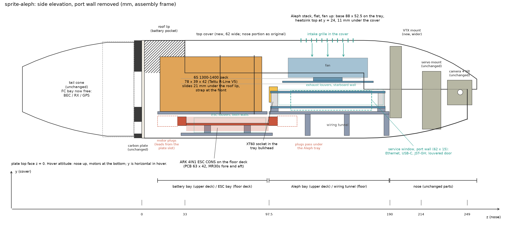
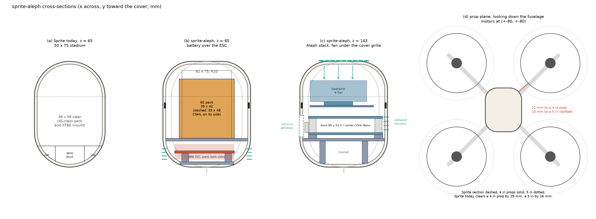
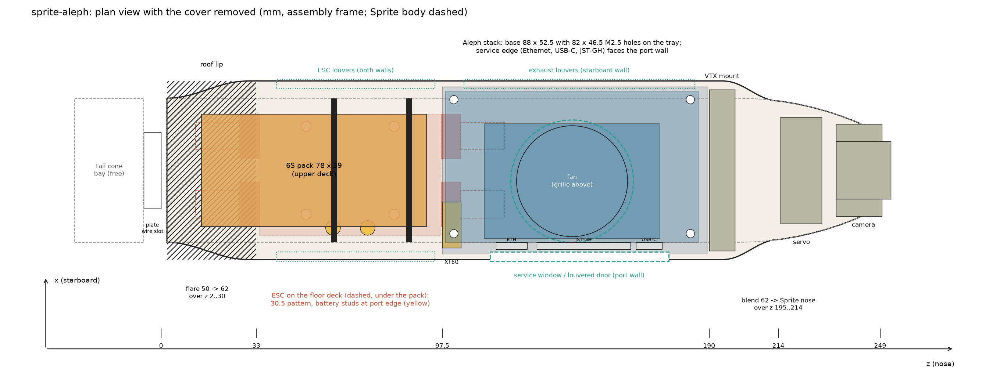

# sprite-aleph: design proposal

Status: proposal for review, 2026-09-29. Nothing is drafted or built yet; `designs/sprite-aleph` does not exist so that
`/initialize-cad` can create it once this is approved. Figures are generated by `figures.py` in this folder and carry the
same numbers as the tables below.

Coordinates throughout are the sprite-drone assembly frame: z along the fuselage from the carbon plate's top face toward
the nose, y toward the top cover, x lateral (starboard positive). In hover the Sprite stands nose up, so z is vertical and
y is horizontal. All lengths in mm.

## 1. Summary

The Sprite is a tail-sitter quad: four small motors on a carbon X plate at the tail of a 249 mm printed fuselage, a
servo-tilted camera in the nose. Its fuselage channel is 46 mm wide inside. The Aleph stack (base board, carrier, Jetson
Orin Nano, heatsink-and-fan) is 89.3 x 55.0 x 40.5, so it cannot enter the channel in any orientation without the body
changing, and the ARK 4IN1 ESC CONS (76.6 x 42.3 with its MR30 connectors) plus a 6S pack plus the Aleph do not fit end to
end in the 157 mm of bay length the fuselage has between the roof and the VTX mount.

Proposal, in one paragraph: widen the fuselage from 50 to 62 mm (same 75 mm height, same tongue-and-groove cover, same
nose from z = 214 to the tip, same tail cone, plate, motor covers and launch pad), give it a flat floor, and stack the
electronics on two decks. The ESC lies flat on the floor of the tail bay with its motor connectors fore and aft, the 6S pack
sits on a deck above it and slides 21 mm under the roof lip, and the Aleph lies flat on a tray in the forward bay with its
fan under an intake grille in the cover and its service ports (Ethernet, USB-C, JST-GH) behind a louvered window in the
port wall. Three printed parts change (main shell, top cover, VTX mount), two are dropped (the old ESC bracket and the
XT60-M mount), three small trays are new, and nine designs are reused as they are (eight printed parts and the carbon
plate). The shell stays 249 mm tall, so it prints on the same printer as the original.

## 2. The Sprite as measured

From `designs/sprite-drone` (contracts and the source STLs; the assembly passed on 2026-09-29):

| item | value | source |
| --- | --- | --- |
| fuselage section | 50 x 75 stadium (two R25 semicircles), 2.0 wall, inner 46 x 71; internal floor at y = -22.5 over two corner cells; central wire duct 20.5 wide | main-shell contract |
| roof (closed ring) | z 2..33; opening from z = 33 | `roofEndZ` 23 in the shell frame (+10) |
| cover seat | groove x = +-23..24.2, y 4.25..8.25, z 28..168; tongue y 4.30..8.20, 0.05 clearance per side | revision 3 measurements |
| side walls end / nose | walls to y = 12.5 until z = 170.16; half-width 25 until z = 200.5; nose stations 223.5 (22.4 half-width, 31.0 deep), 239.8, 248.2; tip 249.3 | shell stations |
| cover | z 33..256.7, arch to y = 37.5, front screw into the VTX mount insert at z = 194, rear screw into the rear cover mount at z = 36.5 | top-cover, vtx-mount, rear-cover-mount contracts |
| carbon plate | 6 thick; centre body exactly 50 x 75 (x = +-25 for abs(y) <= 10); D27 centre hole; two 26.5 x 9 wire slots at y = +-29.5; M3 clamp holes on 30 x 30 | 013_Main Frame.stl, this proposal's measurement |
| motors | axes at (+-80, +-80), 226 mm diagonal; four 3.1 x 4.6 slots at r = 8.75 about each axis: a 12 x 12 pattern, so 15xx-class motors and 3 to 4 in props | frame STL |
| bays today | ESC bracket z 23..68 (board on edge, 30 x 30 holes); XT60-M mount z 68..97 with two sockets (two packs in parallel); battery z 97..187 (46 x 58 x 90 clear, a 4S-class pack); VTX mount z 190..199; servo mount 215..229; camera hinge z 244 | assembly brief |
| wiring | motor and battery leads pass the plate through the -y slot into the shell's wire duct ("lower frame opening", guide steps 4 and 7) | Assembly Guide |
| print size | main shell 188 x 188 x 249.3 standing; cover 224 long | shell envelope |

## 3. The new components

### Aleph stack (from `designs/aleph-stack`, measured with OpenCascade on the KiCad and NVIDIA STEPs)

| item | value |
| --- | --- |
| boards | base 88.0 x 52.5 x 1.56 and carrier 88.0 x 52.5 x 1.57, same outline, R3 corners |
| mounting | four D2.9 (M2.5) holes at 3.0 from each edge: 82.0 x 46.5 |
| heights above the base bottom face | base 1.56; M2.5 standoffs to 11.56; carrier 13.13; module PCB 19.69..20.89; SoC lid 23.52; heatsink-and-fan 23.52..38.52 |
| envelope | x 0..89.31 (Molex overhang 1.31 at the x = 88 edge), y -2.50..52.50 (ix Ethernet overhang 2.50 at the y = 0 edge), z -1.97..38.52: 89.3 x 55.0 x 40.5 |
| service edge (y = 0, long edge) | ix Ethernet (x 17.6..28.4, 7.3 tall), USB-C (x 66.2..75.2), JST-GH row (x 31.7..64.2); the carrier's bottom USB-C (x 42..51) overhangs the same edge |
| nose-facing edge (x = 88, short edge) | base USB-C, Molex 105430 power, carrier USB-C and FFC |
| heatsink | 61 x 40 x 15 with a D38.5 fan intake on top: photo estimates, +-2 / +-2 / +-3 / +-1.5 |
| mass | not measured; estimate 130 to 170 g (module 20 g per vendor listing, comparable Al heatsink-fans 49 to 60 g, two populated 88 x 52.5 boards, standoffs). Weigh it. |

### ARK 4IN1 ESC CONS (measured on `ARK_4_IN_1_ESC_CON_Rev_4_0.step`, sha256 `ff753318ee1d77ca7b248c50790bfa9b92bf79ccbc55fc5d4cb2a0ba125b8e96`, 1614 solids)

| item | value |
| --- | --- |
| PCB | 63.15 x 42.25 x 1.61 |
| overall | 76.6 x 42.3 x 9.43 (ARK states 77.00 x 42.00 x 9.43) |
| mounting | four D3.5 holes on 30.5 x 30.5 with D6 pads (M3, grommets or standoffs) |
| motor connectors | four MR30 sockets at the corners, 17.3 x 15.5 x 6.9 each, overhanging the short PCB edges by 6.7; mating plugs add about 15 |
| battery input | two M2.5 threaded standoffs D5.1 x 4.4 at (+-6, -20), i.e. on one long edge; two 150 mm 10 AWG cables with M2.5 ring terminals are included |
| parts | +4.85 above the PCB top (MR30s), +3.0 elsewhere; -4.58 below (a 12 x 5 x 3 connector and others), so both faces need clearance |
| electrical | 3S to 8S; MR30 limit 30 A continuous / 40 A burst per motor, board 50 / 75 A; 8-pin JST-SH to the flight controller (VBAT, CURR, TELEM, M1..M4, GND); 10-pin SWD debug; 24 g |

### 6S packs (vendor data; the bay is sized for all three)

| pack | L x W x H | mass | note |
| --- | --- | --- | --- |
| Tattu R-Line V5 1400 mAh 6S 150C, XT60 | 78 x 39 x 42 | 222 g | recommended: the most common 5-in racing size, fits the bay flat |
| GNB 1300 mAh 6S 120C LiHV, XT60 | 80 x 38 x 34 | 189 g | lightest; 33 g less than the Tattu |
| CNHL Black Series 1300 mAh 6S 100C, XT60 | 76 x 35 x 48 | 230 g | fits on its side (35 across); 3 mm to the cover at its top corners |

Bay envelope to declare in the contract: 84 (z) x 44 (x) x 49 (y) clear above the deck, with the pack lead exiting toward
the nose. The Sprite's two-socket parallel-pack arrangement is dropped; sprite-aleph carries one 6S pack.

## 4. Why it does not fit, and the options

Width: the Aleph's 55.0 (board plus the Ethernet overhang) against the channel's 46. Length: from the roof end (z 33) to
the VTX mount (z 190) the fuselage offers 157 mm; the Aleph (89.3 + clearance), the ESC (76.6, 107 with mated plugs) and a
78 mm pack need about 280 in a row. The fuselage cannot grow in z: the shell already prints at 249 mm standing, the height
of a 250 to 256 mm printer.

| option | fits | why not chosen |
| --- | --- | --- |
| A. Keep 50 wide, stand the Aleph on edge (40.5 across), body 10 taller | yes, barely | fan 3 mm from a side wall, stack 55 tall from the floor, ESC and pack cannot share the 46 wide tail bay; no room to grow |
| B. Widen to 62, keep 75 tall, two decks (this proposal) | yes | 16 % more skin in the channel; prop clearance drops from 29 to 22 mm with 4 in props |
| C. Widen to 100 and put the pack beside the Aleph | yes | heavy, slow, and the pack still cannot go beside the ESC |
| D. Split the shell at the nose and lengthen | yes | adds a fuselage joint and a part; the length is not the problem once the width is fixed |

## 5. Proposed design

### 5.1 Body section

- Channel section 62 x 75 outside, a rounded rectangle with R20 corners (R18 inside), 2.0 walls: 58 x 71 clear, flat
  floor at y = -35.5 over abs(x) <= 11, no internal floor and no corner cells.
- Ring flare: the carbon plate's centre body is exactly 50 wide, so the shell's footprint on the plate (floor, M3 clamp
  holes, D25 hole, arm fairing roots) stays as the Sprite's, and the ring widens from the 50 x 75 stadium at z = 2 to the
  62 x 75 section at z = 30 (6 mm per side over 28 mm). The groove starts after the flare, at z = 30, and runs to z = 168.
- Roof z 2..33 as today, with the rear cover mount pocket unchanged (it sits on the flat part of the new top).
- Nose blend z 195..214: the 62 wide section blends into the Sprite section at z = 214 (half-width 24.0, floor -33.0,
  cover crown 30.6). From z = 214 to the tip (249.3) the shell is the Sprite's shell, so the servo mount glue face, the
  camera hinge notches and the nose split are untouched. The centreline floor curve (y = -37.5 to z = 170, rising to -22.9
  at the tip) is kept through the blend.
- Top cover: flanks and tongue as the Sprite's (tongue y 4.30..8.20, 0.05 per side), moved to x = +-30.2; the arch becomes
  the same R20 rounded top (crown y = 37.5); intake grille over the fan; nose portion identical to the Sprite's cover from
  z = 214. Both screws stay: rear at z = 36.5 into the rear cover mount, front at z = 194 into the VTX mount insert.
- Arm fairings, nacelle rings, floor and M3 clamp pattern: unchanged (the fairing roots move outward by up to 8 mm where
  the flared ring is wider on the diagonals).

### 5.2 Layout along the fuselage

| z (mm) | floor deck (y -35.5..-19) | upper deck (y -17 up) |
| --- | --- | --- |
| -92..-6 | tail cone, rear mount, launch pad: unchanged. The FC bay under the plate (36 x 36 x 13.6 keep-out) is free for a BEC, receiver or GPS. | |
| 2..33 | motor leads arrive through the plate's -y slot; MR30 plugs z 12..27 | roof lip: battery pocket z 12..33 |
| 27..104 | ESC tray (2 mm plate on the floor, 38 wide) with 6 mm standoffs on the 30.5 pattern; ESC PCB z 34..97, y -27.5..-25.9, components -32.1..-21.05; MR30 sockets 27..34 and 97..104 | battery cradle deck y -19..-17, z 12..96; pack z 14..92 (78 long), strap slots at z 60 and 86 |
| 97.5..189.5 | wiring tunnel 16.5 tall: the nose-end MR30 plugs (z 104..119), the ESC's 8-pin harness, nose cables; tray legs from z = 125 | Aleph tray y -19..-17 glued wall to wall, M2.5 bosses 2.5 tall on 82 x 46.5; base board z 98.5..186.5, x -25.0..27.5; XT60 socket in the tray's tail bulkhead at z 97.5 (port side) |
| 190..256.7 | VTX mount (new, wider) z 190..199; servo mount 215..229; camera mounts and hinge z 244; cover to 256.7 | |

### 5.3 Mounting

- ESC: flat, long axis along z, on a glued-in tray with four M3 standoffs or heat-set inserts on the 30.5 pattern (pattern
  centre x = 0, z = 65.6). The PCB's port edge carries the two battery studs at z 59.6 and 71.6, x = -20. Standoffs 6 mm
  because the ESC has 4.6 mm of parts under the board. Tail-end MR30s face the plate: the motor leads come up through the
  -y plate slot and plug straight in, with 25 mm for the plug body and bend. Nose-end MR30s face the Aleph bay; their plugs
  run under the Aleph tray with 2 mm to spare.
- Battery: a cradle plate at y = -17 with 3 mm side lips and two strap slots (20 mm hook-and-loop strap). The pack slides
  tail-ward 21 mm under the roof lip, which stops it in y and x at the rear; the strap holds the front. Lead toward the
  nose, looping over the pack's top to the XT60 socket.
- Aleph: flat, base board down, fan up, the 88 edge along z. Tray at y = -17 on the same deck height as the cradle,
  glued to both walls, with legs to the floor from z = 125 so the tunnel stays open toward the tail. Four M2.5 bosses
  (heat-set inserts, or reuse the stack's own female standoffs) 2.5 tall clear the base's bottom-side parts (1.97). The
  service edge faces the port wall with 1.5 mm to spare including the Ethernet overhang; the JST-GH-only edge faces
  starboard with 1.5 mm. Nose-facing edge connectors (base USB-C, Molex, carrier USB-C and FFC) have 3.5 mm to the VTX
  mount and are not reachable once the VTX mount is glued; that is a limitation to accept or to answer by moving those
  cables to the port edge.
- VTX mount: re-derived to span the 62 wide channel at z 190..199 (about 56 wide at its ledge), keeping the VTX M2 pattern
  and the D3.2 insert bore on the axis (0, 30, 194). Its step riser now sits on the flat floor and gets a cable notch for
  the tunnel.

### 5.4 Airflow and service access

- Intake grille in the cover over the fan: a D42 zone of slots at z 122..163 (fan centre x = -3.8, z = 142.5, over the SoC
  lid). The fan draws downward onto the fins; the fins exhaust fore and aft along the fuselage.
- Service window in the port wall, z 114..176, y -16..-1 (62 x 15), closed by a snap-in louvered door. It covers the ix
  Ethernet (z 116..127), the JST-GH row (130..163) and the USB-C (165..174) of the base board and the carrier's bottom
  USB-C (140..150), and with the door on it is the bay's port exhaust.
- Exhaust louvers in the starboard wall at the Aleph bay, z 105..185, y -12..0.
- ESC louvers in both walls at the floor deck, z 40..95, y -33..-22, giving cross-flow over the ESC; the floor deck also
  drains through the D27 plate hole into the tail cone, which is open at its tip.
- In hover the fuselage stands in the rotor inflow (air moves along the skin toward the motors), so every opening sees a
  pressure difference and the fan is not the only mover. None of this is validated; the Jetson's thermal telemetry on the
  bench is the first test.

### 5.5 Power and signal

- 6S pack, XT60, to the XT60 socket on the Aleph tray bulkhead, to the ESC's two 10 AWG cables (ring terminals on the
  M2.5 studs), routed along the port side gap on the floor deck (8 mm between the PCB edge and the wall).
- ESC 8-pin JST-SH (VBAT, CURR, TELEM, four DShot lines, GND) to the Aleph base board's JST-GH through the tunnel: an
  adapter cable, pin mapping to confirm against the Aleph's pinout.
- Aleph power: the ESC has no BEC. Either the Aleph base board accepts 6S (25.2 V, 22.8 V LiHV) on its Molex power input,
  or a 6S-rated regulator goes in the freed tail-cone bay. To confirm.
- The Sprite's FC, GPS, receiver and VTX wiring in the guide's steps 3 to 6 are replaced by the Aleph; the VTX, camera and
  servo keep their mounts and reach the Aleph through the tunnel.

## 6. Key numbers and clearances

| quantity | value | note |
| --- | --- | --- |
| body outside / inside | 62 x 75 / 58 x 71, R20 / R18, wall 2.0 | was 50 x 75 / 46 x 71 |
| flare / blend | z 2..30 (50 to 62) / z 195..214 (62 to the Sprite nose) | 12 deg and 20 deg per side |
| groove | x = +-29..30.2, y 4.25..8.25, z 30..168 | same profile, +6 mm per side |
| deck heights | floor deck plate -35.5..-33.5 (ESC); upper deck plate -19..-17 (cradle, Aleph tray) | |
| ESC | PCB y -27.5..-25.9; parts -32.1..-21.05; PCB edges x -22.75 / 19.5 | 2.8 mm from its lowest edge parts to the floor corner, 7.9 mm side gaps |
| MR30 plugs under the Aleph tray | plug body y -27.9..-21.05 vs tray at -19 | 2 mm |
| battery (Tattu, flat) | x +-19.5, y -17..25 | 10.5 to the crown, 8.4 to the corner arc at x = 19.5 |
| battery (CNHL, on its side) | x +-17.5, y -17..31 | 3.3 to the corner arc at x = 17.5 |
| Aleph base bottom / heatsink top | y -14.5 / 24.0 | 11.5 to the crown; the heatsink (40 wide, centred x = -3.8) meets the corner arc with 6.2 at its port edge x = -23.8 and 10.1 at x = 16.2; the +-3 on the heatsink height eats into this |
| Aleph to walls | 1.5 both sides (including the Ethernet overhang) | board x -25.0..27.5 |
| Aleph to VTX mount | 2.2 (Molex overhang at z 187.8 vs 190) | |
| shell height / footprint | 249.3 / 188 x 188 | unchanged; prints on the same printer |
| skin perimeter in the channel | 240 vs 207 | +16 %, about +10 g of PLA |

## 7. Mass, balance and props

Estimates; the Aleph and the motors have not been weighed.

| item | Sprite (one 4S 1500) | sprite-aleph |
| --- | --- | --- |
| printed parts (PLA 1.24, launch pad excluded) | about 200 g | about 245 g (shell +10, VTX mount +2, three trays +42, minus the ESC bracket and XT60 mount 8) |
| carbon plate | 67 g | 67 g |
| FC / ESC | about 18 g | ESC 24 g, Aleph 130 to 170 g |
| battery | about 180 g | 222 g (Tattu 1400) or 189 g (GNB 1300) |
| motors, props, camera, VTX, servo, RX/GPS, wiring | about 180 g | about 180 g |
| all-up | about 640 g | about 890 g |

Centre of mass along z: about 78 mm above the plate today (pack at z 97..187), about 70 mm in the proposal (pack low,
Aleph where the pack was); the change is small because the Aleph takes the pack's old position. The Aleph's IMU then sits
roughly 70 mm from the CG along the thrust axis; PX4 and ArduPilot compensate a known lever arm.

Thrust: 15xx-class 6S motors on 3.5 to 4 in props give roughly 0.7 to 1.0 kgf each, so about 3 to 4.5 : 1 at 890 g. Adequate
for a tail-sitter, not a racing 8 : 1; the motor wind and prop are the user's call (see section 10).

Prop-to-body clearance, nearest body point to a motor axis (the 62 x 75 R20 section is reached above z = 30, so the prop
plane at z 15..25 sees a body between the two rows):

| props | Sprite 50 x 75 | sprite-aleph 62 x 75 R20 |
| --- | --- | --- |
| 3.5 in | 35 mm | 29 mm |
| 4 in | 29 mm | 22 mm |
| 4.5 in | 22 mm | 16 mm |
| 5 in | 16 mm | 10 mm (too close; R25 corners would give 12) |

## 8. Parts plan

| body | design | disposition | notes |
| --- | --- | --- | --- |
| mainFrame | sprite-aleph-main-frame | reuse (copy of sprite-drone-main-frame) | carbon plate, datum |
| rearMount, rearShell, launchPad | reuse | | tail cone as the Sprite's |
| motorCover1..4 | reuse | | |
| servoMount, camMountL, camMountR | reuse | | nose from z = 214 is the Sprite's |
| rearCoverMount | reuse | | roof pocket unchanged |
| mainShell | sprite-aleph-main-shell | new skin | 62 x 75 R20 channel with flat floor, flare z 2..30, blend z 195..214, Sprite nose from 214; groove at +-30.2; service window, louvers, fairing roots; stated as analytic stations plus the Sprite's measured nose stations |
| topCover | sprite-aleph-top-cover | new skin | R20 arch 62 wide, tongue at +-30.2, intake grille, Sprite cover nose from 214 |
| vtxMount | sprite-aleph-vtx-mount | modified | wider plate, same M2 pattern and insert axis (0, 30, 194), cable notch |
| escTray | sprite-aleph-esc-tray | new, prismatic | 38 x 70 x 2 plate, four M3 standoffs on 30.5 at 6 mm, glued to the floor |
| batteryCradle | sprite-aleph-battery-cradle | new, prismatic | deck plate y -19..-17, z 12..96, side lips, two strap slots, rear stop; glued wall to wall |
| alephTray | sprite-aleph-aleph-tray | new, prismatic | deck plate z 97.5..189.5 with legs from z 125, four M2.5 bosses on 82 x 46.5, tail bulkhead with the XT60 pocket, cable slots |
| serviceDoor | sprite-aleph-service-door | new, prismatic (optional) | snap-in louvered door for the 62 x 15 window |
| escMount, xt60mMount | | dropped | replaced by escTray and the XT60 pocket |
| ark4in1Esc | purchased, catalog STEP | new | the ARK STEP staged as construction geometry for clearance checks |
| alephBase, alephCarrier, alephModule, alephHeatsink | purchased, catalog STEP (from `results/build123d/aleph-stack/export/bodies`) or the aleph-stack part designs copied under sprite-aleph | new | clearance checks against the cover, walls and VTX mount |
| battery | purchased, catalog box 78 x 39 x 42 | new | the envelope 84 x 44 x 49 as a clearance body |

Printed designs: 13 today, 14 proposed (15 with the door): 8 reused, 3 re-derived (two skins and the VTX plate), 3 new
trays. Bodies: 17 today, about 24 proposed once the ESC, the four Aleph bodies and the battery are placed as purchased
clearance bodies.

## 9. Build plan in opencad

1. Stage sources: the Sprite's 14 STLs and guide (reused parts and the nose stations), `designs/aleph-stack/sources/*.step`,
   the ARK ESC STEP from
   [ARK-Electronics/ARK_4IN1_ESC](https://github.com/ARK-Electronics/ARK_4IN1_ESC/tree/main/ARK_4IN1_ESC_CONNECTORIZED)
   (sha256 above), this proposal and its figures as the intent document.
2. `/initialize-cad sprite-aleph` with `Goal: assembly`. The drafter copies the nine reused part contracts from
   sprite-drone with their frames unchanged, writes the three skins as station lofts (the new channel section is analytic:
   rounded rectangle 62 x 75 R20; the flare, blend and nose reuse the Sprite's measured stations and outline_16 points), and
   the four prismatic trays from this document. Per the sprite-drone retrospective (R4 to R6): skins as one file each on the
   high-effort model, never partitioned, with station outlines in the contract; prismatic parts on the fast model.
3. Assembly contract acceptance to declare up front (retrospective R1, R3, R11): the cover seat (0.05 per side, the same
   measured planes as sprite-drone), `alephToCover >= 8`, `alephToWalls >= 1.5`, `alephToVtx >= 2`, `batteryEnvelopeClear`,
   `plugsUnderTray >= 2`, `propTipToBody >= 20` with 4 in props as a construction circle, `camSweep` as before, and passages:
   grille to fan, window to the service edge, ESC louvers to the ESC, floor deck to the D27 hole to the tail cone tip.
4. `/create-assembly sprite-aleph`: parts in parallel lanes, then placement, kinematics (camera tilt), gates, report.
   Seeding the reused parts from sprite-drone's built sources keeps their cost at one gate run each; the three skins are the
   cost centre (the Sprite's main shell took 41 turns from a mesh with no outlines; here the sections are stated
   analytically, so fewer).
5. Print check before any electronics: shell (249 tall, standing), cover, trays; slide the cover, fit the ESC and a pack.

## 10. Decisions needed

1. Body: 62 x 75 with R20 corners as proposed, or R25 corners (12 mm to a 5 in prop instead of 10, 2 mm less battery
   corner room) if 5 in props are ever intended. The frame's 12 x 12 motor pattern says 3 to 4 in; confirm motors and props.
2. Battery: Tattu R-Line V5 1400 6S as the reference pack (bay 84 x 44 x 49 fits all three listed).
3. Aleph power: does the base board take 6S directly, or does a BEC go in the tail bay?
4. Service access: the port window with a louvered door as proposed, or a plain wall and cover-off access only (the
   Ethernet and USB-C would then be unusable in the assembled drone).
5. Aleph heatsink height: 15 +-3 is a photo estimate and it sets the 11.5 mm cover clearance; a caliper measurement (or
   NVIDIA's drawing) before drafting.
6. Whether to keep the launch pad and the four-motor-cover reuse as is (yes unless the motors change).

## Sources

- `designs/sprite-drone/` contracts, brief and source STLs; `docs/notes/sprite-drone-retrospective.md`.
- `designs/aleph-stack/` assembly.yaml and brief (STEP measurements of the base, carrier and module).
- [ARK 4IN1 ESC CONS product page](https://arkelectron.com/product/ark-4in1-esc-cons/); [ArduPilot page](https://ardupilot.org/copter/docs/common-ark-4in1-esc_con.html); [pinout](https://docs.arkelectron.com/products/electronic-speed-controller/ark-4in1-esc/pinout); STEP model in the [ARK_4IN1_ESC repository](https://github.com/ARK-Electronics/ARK_4IN1_ESC/tree/main/ARK_4IN1_ESC_CONNECTORIZED).
- [Tattu R-Line V5 1400 mAh 6S](https://www.tattuworld.com/products/tattu-r-line-5-0-1400mah-6s1p-22-2v-150c-fpv-lipo-battery.html); [GNB 1300 mAh 6S 120C](https://rotorvillage.ca/gnb-1300mah-6s-120c-lipo-xt60/); [CNHL Black Series 1300 mAh 6S](https://n-factory.de/CNHL-6S-100C-1300mAh-V2-LiPo-Black-Series-en).
- Jetson Orin Nano module 69.6 x 45, 20 g listing ([nettop](https://www.nettop.gr/index.php/en/boards/nvidia-jetson/nvidia-jetson-orin-nano-8gb.html)); Orin NX/Nano heatsink-fan masses 49 to 183 g ([Auvidea cooling note](https://auvidea.eu/download/D70696_OrinNXNano_Cooling_Solutions_v1.2.pdf)).
