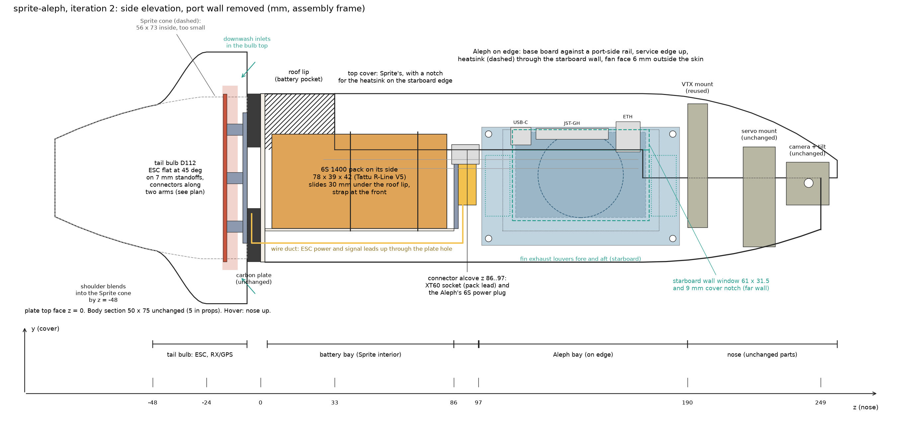
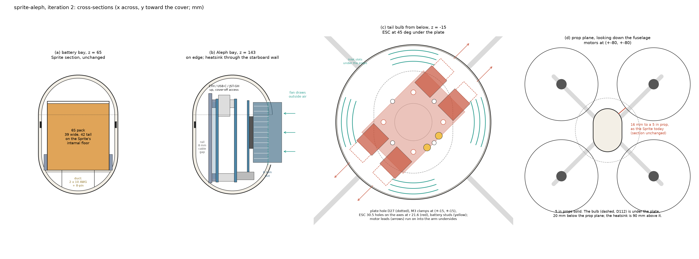
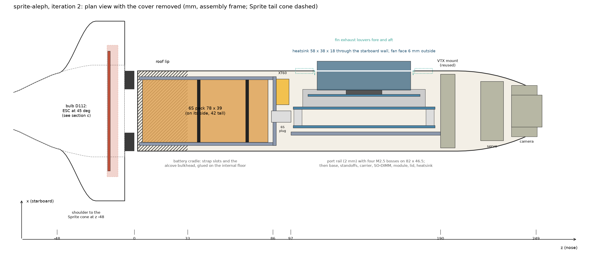

# sprite-aleph: design proposal, iteration 2

Status: proposal for review, 2026-09-29. Nothing is drafted or built; `designs/sprite-aleph` does not exist so that
`/initialize-cad` can create it once this is approved. Iteration 1 (widened body, ESC in the fuselage) is kept under
`v1/`. Figures come from `figures.py` in this folder and carry the same numbers as the tables.

Coordinates are the sprite-drone assembly frame: z along the fuselage from the carbon plate's top face toward the nose,
y toward the top cover, x lateral (starboard positive). In hover the Sprite stands nose up. Lengths in mm.

## 1. What changed since iteration 1

Your answers: 5 in props are expected; battery is my pick; the Aleph takes 6S directly; cover-off access is enough; the
heatsink is 58 x 38 x 18 and 49 g. Your direction: ESC in the tail on the back of the plate on standoffs with its connectors
along an arm; Aleph forward of the battery, turned on its side so the body need not widen; heatsink slightly out of the
side of the shell.

| iteration 1 | iteration 2 |
| --- | --- |
| body widened to 62 x 75 R20; 10 mm to a 5 in prop | body section unchanged (50 x 75 stadium); 16 mm to a 5 in prop, as today |
| Aleph flat under a cover grille | Aleph on edge against a port-side rail, service ports up, heatsink through the starboard wall with its fan face 6 mm outside |
| ESC on the fuselage floor under the battery | ESC under the carbon plate at 45 deg, connectors along two opposite arms, in a new tail bulb |
| battery on an upper deck | battery on the Sprite's own internal floor, pack on its side |
| shell, cover, VTX mount re-derived wider | shell and cover modified locally; VTX mount and the whole nose reused |
| tail unchanged | rear shell, rear mount and launch pad new (the tail cavity is 56 x 73 inside, the ESC needs about D105) |

## 2. The constraints that shaped it

- **5 in props fix the cross-section.** The prop tips come within 49.6 mm of the fuselage axis. The Sprite's 50 x 75
  stadium clears them by 16.2 mm at its nearest point; any straight-sided or taller section costs clearance quickly
  (iteration 1's R20 box: 10 mm), so the body stays exactly as it is. The prop plane is at z 15..25; the heatsink at z 112..173
  and the tail bulb below the plate never meet it.
- **The Aleph on edge fits the stadium.** Stack thickness from a 2.5 mm standoff face to the SoC lid is 26.0; the 18 mm heatsink
  then passes through the starboard wall. The boards are 52.5 tall (55 with the Ethernet jack) and sit in the 66 mm of height
  the section offers at x = -10, with the fan 6 mm outside the skin. No widening.
- **The tail cavity is too small for the ESC.** Measured on the rear shell: 56 x 73 inside at the rim (r 28 at +-x, r 36.5 at
  +-y), constant to z = -30, then tapering; the arm undersides are 12 mm wide tents to z = -24. The ESC at 45 deg has its PCB
  corners at r 38, its MR30 housings at r 43 and the mated plugs at r 51; at 0 or 90 deg it is 77 long against 73. So the
  tail gets a bulb: D112 outside, z -6..-24, shouldering into the Sprite cone by z = -48. The launch pad grips the cone's top
  30 mm today and follows.
- **The ESC pattern is 30.5 mm square, the frame clamp pattern 30 mm square.** Screwed straight to the clamp screws the ESC
  would sit at 0 or 90 deg with 0.25 mm of hole slack. The 45 deg orientation you asked for goes through the new rear mount:
  its four M3 inserts sit on the axes at r 21.6, and it is itself clamped by the frame's M3 screws.

## 3. Components (measured / stated)

| item | value | source |
| --- | --- | --- |
| Aleph base and carrier | 88.0 x 52.5, D2.9 holes on 82.0 x 46.5, 3.0 from the edges | `designs/aleph-stack` (KiCad STEPs) |
| stack heights above the base bottom face | base 1.56, standoffs to 11.56, carrier 13.13, module 19.69..20.89, SoC lid 23.52, heatsink to 41.52 (18) | aleph-stack contract, heatsink from you |
| heatsink | 58 x 38 x 18, 49 g, fan on top, fins exhaust at the 58 ends | you |
| service edge (base y = 0) | ix Ethernet x 17.6..28.4 (7.3 tall, overhangs 2.5), JST-GH x 31.7..64.2, USB-C x 66.2..75.2; carrier bottom USB-C x 42..51 overhangs the same edge | aleph-stack contract |
| base x = 88 edge | Molex 105430 power (y 6.65..15.39, overhangs 1.31), USB-C; carrier USB-C and FFC | aleph-stack contract |
| ARK 4IN1 ESC CONS | PCB 63.15 x 42.25 x 1.61; 76.6 x 42.3 x 9.43 with MR30s; holes D3.5 on 30.5 x 30.5; battery studs M2.5 at (+-6, -20); parts +4.85 / -4.58; 24 g | ARK STEP Rev 4.0, sha256 `ff753318...5b8e96` |
| battery, recommended | Tattu R-Line V5 1400 mAh 6S 150C: 78 x 39 x 42, 222 g | vendor |
| alternatives that fit the same pocket | GNB 1300 6S 120C 80 x 38 x 34, 189 g; CNHL Black 1300 6S 76 x 35 x 48, 230 g | vendor |
| Sprite section | 50 x 75 stadium, wall 2.0, inner 46 x 71; internal floor y = -22.5 over two corner cells; wire duct 20.5 wide under it | main-shell contract |
| Sprite tail | cavity 56 x 73 inside to z = -30; arm undersides 12 wide to z = -24; cone to the open tip at z = -92 | rear shell STL, this proposal |
| frame | centre body 50 x 75, D27 centre hole, clamp holes M3 on 30 x 30, motor slots on a 12 x 12 pattern at (+-80, +-80) | frame STL |

## 4. Layout

| z (mm) | what is there |
| --- | --- |
| -92..-48 | Sprite tail cone, unchanged profile (open tip is the air exit) |
| -48..-24 | shoulder: the bulb blends into the cone |
| -24..-6 | **tail bulb**, D112 outside, 0.8 wall. Inside: the new rear mount clamp plate (z -8..-6), the ESC on 7 mm standoffs (PCB z -16.6..-15, connectors z -17..-10) at 45 deg with its MR30s pointing along the +x+y and -x-y arms, receiver and GPS space; inlet slots in the top skin and side wall, four arm tents continue outward as today |
| -6..0 | carbon plate (unchanged); leads pass the D27 centre hole |
| 0..2 | shell floor (unchanged) |
| 3..86 | **battery bay**: the Sprite's internal floor (y = -22.5) and wire duct kept; pack on its side (39 wide, 42 tall) in a glued cradle, slides 30 mm under the roof lip (z 2..33), strap slots at z 40 and 70 |
| 86..97 | **connector alcove**: cradle bulkhead at z 86; XT60 socket (pack lead, axis along y) at x 4..20; the Aleph's 6S power plug on the base's tail-facing edge; the duct's cables emerge here |
| 97..190 | **Aleph bay**: on edge. Port rail (x -15..-13) with four M2.5 bosses on 82 x 46.5; base board x -10.5..-8.94, y -30..22.5, z 98.5..186.5, service edge up; heatsink x 13..31 through the starboard wall window (z 112..173, y -19..12.5) and a 9 mm notch in the cover's lower starboard edge (y 12.5..21.5); fin-exhaust louvers fore and aft (z 100..111, 174..185) |
| 190..257 | **nose**: VTX mount (z 190..199), servo mount, camera mounts, cover nose: all the Sprite's parts, unchanged |

### 4.1 Aleph on edge (section b)

- Rail face at x = -13, 2 mm plate glued to the U bottom and, through short ribs, to the port wall: an 8 mm cable gap behind it.
  Lower bosses reach y = -30, inside the U's curve at x = -14 (limit -30.7).
- Base bottom-side parts x -12.47..-10.5 (0.5 mm off the rail), base -10.5..-8.94, M2.5 standoffs to 1.06, carrier 1.06..2.63,
  SO-DIMM housing to 13.49 at y -28.5..-23.5 (2.6 mm from the skin), module 9.19..10.39, SoC lid to 13.02, heatsink 13.02..31.02.
- Board y -30..22.5: bottom edge 3.0 mm from the skin at x = -10.5, microSD 2.3; the Ethernet jack tops out at y = 25, 8.7 mm
  under the cover crown at that x. Ethernet, both USB-Cs and the JST-GH row point up: reachable with the cover off.
- Heatsink centre y = 1.3 (the SoC lid is 5 mm above the board centre), y -17.7..20.3, z 113.5..171.5. Its bottom corner sits
  1.5 mm inside the skin at x = 22; the window is 1.3 mm larger than the block all round. The fan face is at x = 31, 6 mm
  outside the skin (x = 25), drawing outside air. The fins (inner ~10 mm of the block) are inside the wall, so their exhaust
  leaves through louvers fore and aft of the window. Push the block out to 10 mm if you would rather have the fin ends
  outside too; the rail then moves to x = -9 and the cable gap shrinks to 4 mm.
- The cover notch removes the starboard tongue from z 112 to its end at 151 (39 of its 118 mm) and the shell window cuts the
  starboard groove over z 112..168; the port tongue and groove and both screws are untouched.
- The base's Molex power connector faces the tail (the x = 88 edge is at z 98.5, its plug mates along -z into the alcove); the
  carrier's USB-C and FFC face the same way. The x = 0 edge faces the VTX mount, 3.5 mm away.

### 4.2 Battery bay (section a)

The Sprite interior is right for a 6S pack on its side: at y = -22.5 the inner section is 41.4 wide, the Tattu is 39 wide
and 42 tall (top at y = 19.5, 16 mm under the crown). GNB 1300 (38 x 34) and CNHL 1300 (35 wide, 48 tall, 2 mm to the arch
at its corners) fit the same pocket. Pocket z 3..86 (83 long) against 76..80 long packs. The pack goes in lead-first toward
the nose, slides back under the roof lip, and a hook-and-loop strap through the cradle's lip slots holds the front. The
cradle also carries the alcove bulkhead and the XT60 socket.

### 4.3 Tail bulb and ESC (section c)

- New rear mount: a 2 mm clamp plate under the plate (z -8..-6), D52 centre with the four M3 clamp holes at (+-15, +-15)
  and four M3 inserts on the axes at r 21.6 for the ESC's 30.5 pattern turned 45 deg; four radial lugs on the axes to r 54
  with radial M3 inserts at z = -10 that take the bulb's four side screws. The clamp screws shorten from M3 x 30 to about
  M3 x 14 with low nuts or inserts: a 30 mm screw would run through the ESC.
- ESC: 7 mm standoffs, PCB z -16.6..-15, MR30 sockets toward the plate (z -17..-10), connectors along the +x+y and -x-y arms.
  The two motor leads from each of those arms plug straight in; the other two arms' leads cross 40 mm under the plate.
  Battery studs at (18.4, -9.9) and (9.9, -18.4), 21 mm from the axis; the two 10 AWG cables and the 8-pin harness go up
  through the D27 hole into the wire duct (about 120 mm to the alcove; 150 mm cables supplied).
- Bulb: D112 outside, 0.8 wall (the Sprite's), z -6..-24 cylindrical, top skin at z -6 between the four arm tents outside the
  plate's outline, shoulder to the Sprite cone profile by z = -48, cone and open tip as today. Inner r 55.2 against the plug
  corners at r 51 (4 mm) and the PCB corners at r 38. Four radial M3 screws at z = -10 on the axes. Inlet slots in the top
  skin at r 44..52 and in the side wall facing the four wake columns; air leaves the open tip, as in the Sprite.
- Slimmer alternative: a pod aligned with the ESC's diagonal, 120 x 66 oval outside, merging into the two arm tents it
  points along; same parts, half the frontal area, asymmetric look.
- Launch pad: new cup, inner D114 x 20 gripping the bulb, four legs to the Sprite pad's 170 x 150 footprint.

### 4.4 Cooling summary

Aleph fan intake outside the skin; fin exhaust through two louver groups on the starboard wall; the bay also breathes
through the cover-off access gap when open. ESC in the bulb between the four wake columns, inlets on the top and sides,
exhaust down the cone to the open tip: the Sprite's own tail path, now with a bigger bay. Nothing here is validated; the
Jetson's thermal telemetry on the bench is the first test, and the fan can be pushed further out if the fins need it.

## 5. Numbers and clearances

| quantity | value |
| --- | --- |
| body section | 50 x 75 stadium, unchanged; 16.2 mm to a 5 in prop tip |
| Aleph rail face / base bottom / lid top / fan face | x -13 / -10.5 / 13.02 / 31.02 |
| Aleph board | y -30..22.5, z 98.5..186.5; holes y -27, 19.5, z 101.5, 183.5 |
| board and parts to the skin | bottom edge 3.0 (x -10.5); microSD 2.3; SO-DIMM corner 2.6; heatsink bottom corner 1.5 at x 22 |
| Ethernet top to cover crown | 8.7 at x -8.9 (jack top y 25, crown inner 33.7 there) |
| heatsink window / cover notch | z 112..173; y -19..12.5 in the wall, 12.5..21.5 in the cover; gap 1.3 around the block |
| Aleph to VTX mount / to alcove bulkhead | 3.5 / 9 (Molex overhang at z 97.2, bulkhead at 88) |
| battery (Tattu on its side) | x +-19.5, y -22.5..19.5, z 5..83; 2.2 mm to the U corner, 16 under the crown, 5 mm pocket slop |
| ESC in the bulb | PCB z -16.6..-15; corners r 38, MR30 housings r 43, mated plugs r 51 vs inner r 55.2 |
| clamp nuts to ESC top | z -12 vs PCB top -15: 3 mm (MR30s are off the nut positions) |
| bulb | D112 x 18 straight, shoulder to z -48; top skin 26 mm below the prop plane |
| shell height / footprint | 249.3 / 188 x 188, unchanged; bulb prints rim-down on a D112 footprint |

## 6. Mass, balance, props

| item | Sprite (one 4S 1500) | sprite-aleph |
| --- | --- | --- |
| printed parts (PLA 1.24, launch pad excluded) | about 200 g | about 230 g (bulb +22, cradle 10, rail 8, collar 3, minus the ESC bracket and XT60 mount) |
| carbon plate | 67 g | 67 g |
| FC / ESC | about 18 g | ESC 24 g, Aleph about 135 g (heatsink 49, module 20, two boards, hardware) |
| battery | about 180 g | 222 g (Tattu) or 189 g (GNB) |
| motors, props, camera, VTX, servo, RX/GPS, wiring | about 180 g | about 180 g |
| all-up | about 640 g | about 860 g |

Centre of mass about 63 mm above the plate (Sprite about 78): the ESC and bulb sit below the plate and the pack sits low;
the Aleph takes the pack's old position. The Aleph's IMU is then about 80 mm from the CG along the thrust axis.

Prop clearance is the Sprite's: 16 mm with 5 in props, 29 mm with 4 in. The frame's M3-slotted 12 x 12 motor pattern suits
15xx to 20xx class motors; with 5 in props on 6S the motor wind is yours to confirm.

## 7. Parts plan

| body | design | disposition | notes |
| --- | --- | --- | --- |
| mainFrame | sprite-aleph-main-frame | reuse | carbon plate, datum |
| motorCover1..4, vtxMount, servoMount, camMountL, camMountR, rearCoverMount | reuse | | seven Sprite designs, ten bodies |
| mainShell | sprite-aleph-main-shell | modified | Sprite shell with: starboard window z 112..173, y -19..12.5 with a 3 mm frame; louvers z 100..111 and 174..185; internal floor and corner cells ending at z 86; glue seats for the cradle and rail; everything else as measured |
| topCover | sprite-aleph-top-cover | modified | Sprite cover with a 61 x 9 notch in its lower starboard edge (tongue removed there) |
| rearShell | sprite-aleph-rear-shell | new skin | the bulb: D112 cylinder z -6..-24, top skin with four arm notches, shoulder to the Sprite cone stations by z -48, Sprite cone to the tip; four M3 side screw holes at z -10 on the axes; inlet slots |
| rearMount | sprite-aleph-rear-mount | new, prismatic | clamp plate with the 30 x 30 M3 holes, four M3 inserts at r 21.6 on the axes, four radial lugs with M3 inserts at r 52, z -10 |
| launchPad | sprite-aleph-launch-pad | new, prismatic | cup D114 x 20 plus four legs |
| batteryCradle | sprite-aleph-battery-cradle | new, prismatic | saddle on the internal floor, lips with strap slots, alcove bulkhead at z 86 with the XT60 pocket |
| alephRail | sprite-aleph-aleph-rail | new, prismatic | 2 mm rail x -15..-13, z 97.2..190, four M2.5 heat-set bosses, ribs to the port wall, microSD cutout |
| heatsinkCollar | sprite-aleph-heatsink-collar | new, optional | frame closing the 1.3 mm gap around the heatsink in the wall and cover |
| escMount, xt60mMount | | dropped | |
| ark4in1Esc, alephBase, alephCarrier, alephModule, alephHeatsink (58 x 38 x 18), battery box 78 x 39 x 42 | purchased, catalog STEP / box | new | clearance bodies |

Printed designs: 13 today, 14 proposed (15 with the collar): 7 reused, 2 modified, 5 new. Bodies: 17 today, about 25 with the
purchased clearance bodies.

## 8. Build plan in opencad

1. Stage sources: the Sprite's 14 STLs and guide, `designs/aleph-stack/sources/*.step`, the ARK ESC STEP
   ([repository](https://github.com/ARK-Electronics/ARK_4IN1_ESC/tree/main/ARK_4IN1_ESC_CONNECTORIZED)), this proposal.
2. `/initialize-cad sprite-aleph`, `Goal: assembly`. Reused parts: copy the sprite-drone contracts unchanged. Modified skins:
   copy the Sprite contracts, keep every unchanged station and face as measured, and state the window, notch and floor end as
   new features with void and solid probes; the Sprite mesh stays the source for the unchanged regions only (a whole-part
   fidelity band would fail on the window by design). New skin (bulb): analytic cylinder and shoulder plus the Sprite cone's
   measured stations below z -48. Skins one file each on the high-effort model (retrospective R5, R6); prismatic parts on the
   fast model.
3. Assembly acceptance to declare (R1, R3, R11): cover seat as sprite-drone; `heatsinkWindowGap 1.0..1.6`,
   `alephToSkin >= 1.5`, `alephToVtx >= 3`, `ethernetToCover >= 5`, `batteryEnvelopeClear`, `escToBulb >= 3`, `clampNutsToEsc >= 2`,
   `propTipToBody >= 15` with a 5 in construction circle; passages: fan face to outside, louvers to the fin ends, duct from the
   D27 hole to the alcove, bulb inlets to the tip; `camSweep` as before.
4. `/create-assembly sprite-aleph`. Seeding the seven reused parts and the two modified skins from sprite-drone's built
   sources keeps their cost low; the bulb is the one new free-form skin.
5. Print check: shell and cover (unchanged size), bulb rim-down, then fit the heatsink through the window before wiring.

## 9. Open points

1. Cover installation: I assume the Sprite cover drops in by flexing its flanks (tongue 1.15 mm deep). If it must slide in
   along the groove, the heatsink notch has to become a slot open to the cover's rear end, or the heatsink goes on after
   the cover (not possible with NVIDIA's under-module spring bracket).
2. Bulb shape: round D112 (baseline) or the 120 x 66 diagonal pod.
3. Heatsink protrusion: 6 mm (fan outside, fins inside with louvers) or 10 mm (fin ends outside too, 4 mm cable gap).
4. Aleph 6S input: I assume the base board's Molex on the x = 88 edge, mating along the board edge; confirm which connector
   and its mating direction so the alcove depth (11 mm) is right.
5. Shell material: the starboard cut removes 61 mm of one wall; PETG or ASA rather than PLA, plus the collar, is my
   recommendation for the modified shell.
6. Where the receiver and GPS go: the bulb has room; a GPS wants the top of the airframe, which in hover is the nose.

## Sources

- `designs/sprite-drone/` contracts and source STLs; `designs/aleph-stack/`; `docs/notes/sprite-drone-retrospective.md`.
- [ARK 4IN1 ESC CONS](https://arkelectron.com/product/ark-4in1-esc-cons/), [pinout](https://docs.arkelectron.com/products/electronic-speed-controller/ark-4in1-esc/pinout), STEP in the [ARK repository](https://github.com/ARK-Electronics/ARK_4IN1_ESC/tree/main/ARK_4IN1_ESC_CONNECTORIZED).
- [Tattu R-Line V5 1400 mAh 6S](https://www.tattuworld.com/products/tattu-r-line-5-0-1400mah-6s1p-22-2v-150c-fpv-lipo-battery.html); [GNB 1300 mAh 6S 120C](https://rotorvillage.ca/gnb-1300mah-6s-120c-lipo-xt60/); [CNHL Black Series 1300 mAh 6S](https://n-factory.de/CNHL-6S-100C-1300mAh-V2-LiPo-Black-Series-en).
